# Formation Terraform sur Microsoft Azure — Cahier de labs

**Durée :** 2 jours (16 h) · **Niveau :** débutant à intermédiaire · **Cloud :** Microsoft Azure
**Versions de référence :** Terraform ≥ 1.9 · provider `hashicorp/azurerm` ~> 4.0 · Azure CLI ≥ 2.60

Ce cahier adapte à Azure les 16 labs de la formation Terraform AWS. La progression pédagogique est conservée : les labs 02 à 09 font évoluer **un même projet fil rouge** (un serveur web Linux), les labs suivants abordent l'état distant, HCP Terraform, les templates, le multi‑provider et enfin un réseau complet.

---

## Planning des 2 jours

### Jour 1 — Les fondamentaux (8 h)

| Horaire | Séquence | Lab | Durée lab |
|---|---|---|---|
| 08:30 – 09:15 | Cours : IaC, Terraform, workflow, Azure Resource Manager | — | — |
| 09:15 – 09:45 | Installation et authentification Azure | [Lab 01](lab01-installation.md) | 30 min |
| 09:45 – 10:45 | Première infrastructure Azure | [Lab 02](lab02-premiere-infrastructure.md) | 60 min |
| 10:45 – 11:00 | *Pause* | | |
| 11:00 – 11:20 | Les outputs | [Lab 03](lab03-outputs.md) | 20 min |
| 11:20 – 12:30 | Cours + lab : les variables | [Lab 04](lab04-variables.md) | 50 min |
| 13:30 – 14:45 | Cours + lab : les modules | [Lab 05](lab05-modules.md) | 60 min |
| 14:45 – 15:45 | Provisioners | [Lab 06](lab06-provisioners.md) | 45 min |
| 15:45 – 16:00 | *Pause* | | |
| 16:00 – 16:45 | Commandes Terraform | [Lab 07](lab07-commandes.md) | 30 min |
| 16:45 – 17:30 | Méta‑arguments (`count`, `for_each`) | [Lab 08](lab08-meta-arguments.md) | 40 min |

### Jour 2 — État, collaboration et réseau (8 h)

| Horaire | Séquence | Lab | Durée lab |
|---|---|---|---|
| 08:30 – 09:15 | Sources de données | [Lab 09](lab09-data-sources.md) | 30 min |
| 09:15 – 09:45 | Lire l'état d'un autre projet | [Lab 10](lab10-lecture-state.md) | 20 min |
| 09:45 – 10:45 | État distant dans Azure Storage | [Lab 11](lab11-state-distant-azure.md) | 45 min |
| 10:45 – 11:00 | *Pause* | | |
| 11:00 – 12:30 | HCP Terraform + GitHub | [Lab 12](lab12-hcp-terraform.md) | 75 min |
| 13:30 – 14:15 | Fonction `templatefile` et RBAC | [Lab 13](lab13-templatefile.md) | 40 min |
| 14:15 – 15:00 | Multi‑provider (Azure + GitHub) | [Lab 14](lab14-multi-provider.md) | 40 min |
| 15:00 – 15:15 | *Pause* | | |
| 15:15 – 16:15 | Réseau virtuel complet (VNet) | [Lab 15](lab15-vnet.md) | 50 min |
| 16:15 – 17:00 | VM dans le VNet | [Lab 16](lab16-vm-dans-vnet.md) | 40 min |
| 17:00 – 17:30 | Bilan, quiz, `terraform destroy` général | — | — |

---

## Vue d'ensemble du parcours

```mermaid
flowchart LR
    subgraph J1["Jour 1 — Projet fil rouge"]
        L01["01 Installation"] --> L02["02 1re infra"] --> L03["03 Outputs"] --> L04["04 Variables"]
        L04 --> L05["05 Modules"] --> L06["06 Provisioners"] --> L07["07 Commandes"] --> L08["08 count"]
    end
    subgraph J2["Jour 2 — Industrialisation"]
        L09["09 Data sources"] --> L10["10 Lire un state"] --> L11["11 State Azure"] --> L12["12 HCP Terraform"]
        L13["13 templatefile"] --> L14["14 Multi-provider"]
        L15["15 VNet complet"] --> L16["16 VM dans VNet"]
    end
    L08 --> L09
    L12 --> L13
    L14 --> L15
```



---

## Correspondance AWS → Azure

| Lab d'origine (AWS) | Concept AWS | Équivalent Azure utilisé |
|---|---|---|
| Lab 1 | Utilisateur IAM + clés d'accès | `az login` + Service Principal (`ARM_CLIENT_ID`…) |
| Lab 2 | `aws_instance` (EC2) | `azurerm_linux_virtual_machine` + NIC + IP publique |
| Lab 2 | VPC / subnet / security group | `azurerm_virtual_network` / `azurerm_subnet` / `azurerm_network_security_group` |
| Lab 3 | `public_ip`, `public_dns` | `azurerm_public_ip.ip_address`, `.fqdn` |
| Lab 4 | Map `AMIS` par région | Map de tailles de VM par environnement + map d'images |
| Lab 5 | Module `dynamic-keys` | Module registre `Azure/naming/azurerm` + `tls_private_key` |
| Lab 6 | Utilisateur `ubuntu` | Utilisateur `azureuser` |
| Lab 9 | `data "aws_ami"` | `data "azurerm_platform_image"` |
| Lab 11 | State sur Terraform Cloud | Backend `azurerm` (Storage Account + verrou par bail de blob) |
| Lab 12 | Terraform Cloud + creds AWS | HCP Terraform + variables `ARM_*` |
| Lab 13 | Bucket S3 + politique IAM | Storage Account + rôle personnalisé Azure RBAC |
| Lab 14 | Security group egress | Règles NSG sortantes |
| Lab 15 | Internet Gateway, route table, AZ | Routage système Azure, route table, NAT Gateway, zones sur les ressources |
| Lab 16 | EC2 + key pair dans le VPC | VM Linux + clé SSH dans le VNet |

---

## Prérequis participants

- Un abonnement Azure (ou un groupe de ressources dédié avec le rôle **Contributor**). Le lab 13 nécessite en plus **Owner** ou **User Access Administrator** sur son groupe de ressources.
- Un poste Linux, macOS ou Windows avec WSL2, et VS Code avec l'extension **HashiCorp Terraform**.
- Un compte GitHub (labs 12 et 14) et un compte HCP Terraform gratuit (lab 12).
- Une paire de clés SSH (`ssh-keygen -t rsa -b 4096`).

## Conventions

- Chaque participant choisit un **identifiant unique** en minuscules, par exemple `student01`, noté `<identity>` dans les labs. Il sert de préfixe à tous les noms de ressources pour éviter les collisions.
- Région par défaut : `francecentral` (à adapter si la taille `Standard_B1s` n'y est pas disponible ; alternative : `Standard_B2ats_v2`).
- Arborescence conseillée :

```text
~/terraform-azure/
├── terraform/          # projet fil rouge (labs 02 → 09, puis 12)
├── lab04-exercice/     # exercice du lab 04, réutilisé au lab 06
├── lab10/  lab11/  lab13/  lab14/
└── lab15-16/           # réseau complet + VM
```

## Coûts et nettoyage

Les ressources utilisées sont petites (VM B1s, IP Standard, Storage LRS) mais **facturées à l'heure**. Le NAT Gateway du lab 15 est la ressource la plus coûteuse : détruisez‑la en fin de lab. À la fin de chaque journée :

```bash
terraform destroy
# filet de sécurité : supprimer le groupe de ressources complet
az group delete --name rg-<identity>-lab --yes --no-wait
```

## Ce qui a changé par rapport aux labs d'origine

- `terraform taint` (déprécié) est remplacé par `terraform apply -replace=<adresse>`.
- `terraform refresh` (déprécié) est remplacé par `terraform apply -refresh-only`.
- Les secrets (client secret, tokens) ne sont **jamais** écrits dans le code ni dans `terraform.tfvars` : ils passent par des variables d'environnement.
- Les blocs `moved` (Terraform ≥ 1.1) sont utilisés au lab 05 pour refactoriser sans recréer les ressources.
# terraform-azure-labs
