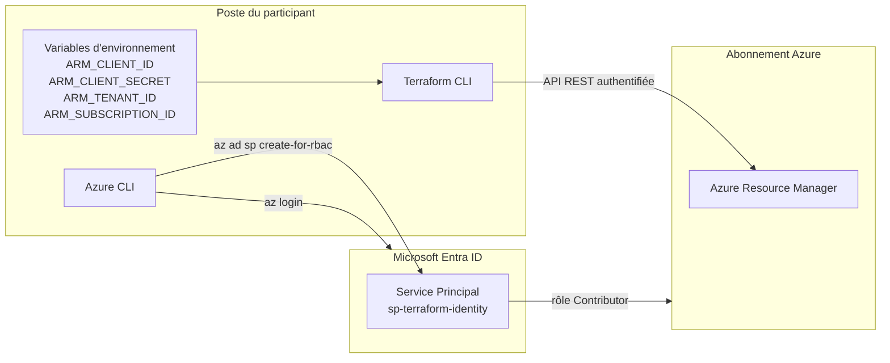

# Lab 01 — Installation de Terraform et connexion à Azure

> **Durée :** 30 min · **Jour 1** · **Adapté de :** Lab 1 *Terraform installation*

## Objectif

Préparer le poste de travail du participant pour toute la formation :

- installer Terraform et l'Azure CLI ;
- s'authentifier sur Azure, d'abord de façon interactive (`az login`), puis avec un **Service Principal**, l'équivalent Azure de l'utilisateur IAM « programmatique » d'AWS ;
- vérifier que Terraform peut parler à l'API Azure Resource Manager.

## Schéma de l'objectif



---

## Tâche 1 : installer Terraform

### Sur Ubuntu / Debian

```bash
# 1. Clé GPG HashiCorp (la méthode apt-key est dépréciée)
wget -O- https://apt.releases.hashicorp.com/gpg | \
  sudo gpg --dearmor -o /usr/share/keyrings/hashicorp-archive-keyring.gpg

# 2. Dépôt officiel HashiCorp
echo "deb [signed-by=/usr/share/keyrings/hashicorp-archive-keyring.gpg] \
https://apt.releases.hashicorp.com $(lsb_release -cs) main" | \
  sudo tee /etc/apt/sources.list.d/hashicorp.list

# 3. Installation
sudo apt-get update && sudo apt-get install -y terraform
```

### Sur RHEL / CentOS / Rocky

```bash
sudo yum install -y yum-utils
sudo yum-config-manager --add-repo https://rpm.releases.hashicorp.com/RHEL/hashicorp.repo
sudo yum -y install terraform
```

### Sur Windows

```powershell
winget install HashiCorp.Terraform
```

### Vérifier l'installation

```bash
terraform version
```

Résultat attendu (la version peut être plus récente) :

```text
Terraform v1.9.x
on linux_amd64
```

Activez l'autocomplétion (optionnel) :

```bash
terraform -install-autocomplete
```

---

## Tâche 2 : installer l'Azure CLI

```bash
# Ubuntu / Debian
curl -sL https://aka.ms/InstallAzureCLIDeb | sudo bash

# Windows
winget install Microsoft.AzureCLI

az version
```

---

## Tâche 3 : s'authentifier sur Azure

### Étape 3.1 : connexion interactive

```bash
az login
# Si plusieurs abonnements : choisir celui de la formation
az account list --output table
az account set --subscription "<SUBSCRIPTION_ID>"
az account show --query "{abonnement:name, id:id, tenant:tenantId}" -o table
```

> Avec `az login`, Terraform réutilise automatiquement votre session Azure CLI. C'est la méthode la plus simple **pour un poste de développement**.

### Étape 3.2 : créer un Service Principal (accès programmatique)

Pour une utilisation automatisée (CI/CD, HCP Terraform au lab 12), on crée une identité applicative dédiée. C'est l'équivalent de l'utilisateur IAM avec « accès par programmation » des labs AWS.

```bash
SUBSCRIPTION_ID=$(az account show --query id -o tsv)

az ad sp create-for-rbac \
  --name "sp-terraform-<identity>" \
  --role "Contributor" \
  --scopes "/subscriptions/$SUBSCRIPTION_ID"
```

Résultat (à conserver **en lieu sûr**, le mot de passe ne sera plus affiché) :

```json
{
  "appId": "00000000-0000-0000-0000-000000000000",
  "displayName": "sp-terraform-student01",
  "password": "xxxxxxxxxxxxxxxxxxxxxxxxxxxxxxxx",
  "tenant": "11111111-1111-1111-1111-111111111111"
}
```

> **Bonne pratique :** en entreprise, on limite le `--scopes` à un groupe de ressources et on évite le rôle *Owner*. Le rôle *Contributor* sur l'abonnement est utilisé ici pour simplifier la formation.

### Étape 3.3 : exporter les variables d'environnement

Le provider `azurerm` lit automatiquement ces variables :

```bash
export ARM_CLIENT_ID="<appId>"
export ARM_CLIENT_SECRET="<password>"
export ARM_TENANT_ID="<tenant>"
export ARM_SUBSCRIPTION_ID="<SUBSCRIPTION_ID>"
```

Sous PowerShell :

```powershell
$env:ARM_CLIENT_ID="<appId>"
$env:ARM_CLIENT_SECRET="<password>"
$env:ARM_TENANT_ID="<tenant>"
$env:ARM_SUBSCRIPTION_ID="<SUBSCRIPTION_ID>"
```

> Vous pouvez placer ces lignes dans un fichier `~/.azure-tf.env` (droits `600`) et le charger avec `source ~/.azure-tf.env`. **Ne le versionnez jamais dans Git.**

---

## Tâche 4 : test de connexion avec Terraform

Créez un répertoire de test et un fichier `main.tf` :

```bash
mkdir -p ~/terraform-azure/lab01 && cd ~/terraform-azure/lab01
```

```hcl
# main.tf
terraform {
  required_providers {
    azurerm = {
      source  = "hashicorp/azurerm"
      version = "~> 4.0"
    }
  }
}

provider "azurerm" {
  features {}
  # subscription_id est lu depuis ARM_SUBSCRIPTION_ID
}

data "azurerm_client_config" "current" {}

output "connexion" {
  value = {
    tenant_id       = data.azurerm_client_config.current.tenant_id
    subscription_id = data.azurerm_client_config.current.subscription_id
    client_id       = data.azurerm_client_config.current.client_id
  }
}
```

```bash
terraform init
terraform apply
```

Résultat attendu : les identifiants de votre tenant, de votre abonnement et de votre Service Principal s'affichent, **sans créer aucune ressource**.

---

## Vérification

- [ ] `terraform version` affiche une version ≥ 1.9.
- [ ] `az account show` affiche l'abonnement de la formation.
- [ ] `terraform apply` dans `lab01` affiche l'output `connexion`.

## Pour aller plus loin

- Différence entre `az login` (utilisateur), Service Principal avec secret, Managed Identity et **OIDC / Workload Identity Federation** (sans secret, recommandé pour la CI/CD).
- `tfenv` ou `tenv` pour gérer plusieurs versions de Terraform sur un même poste.
