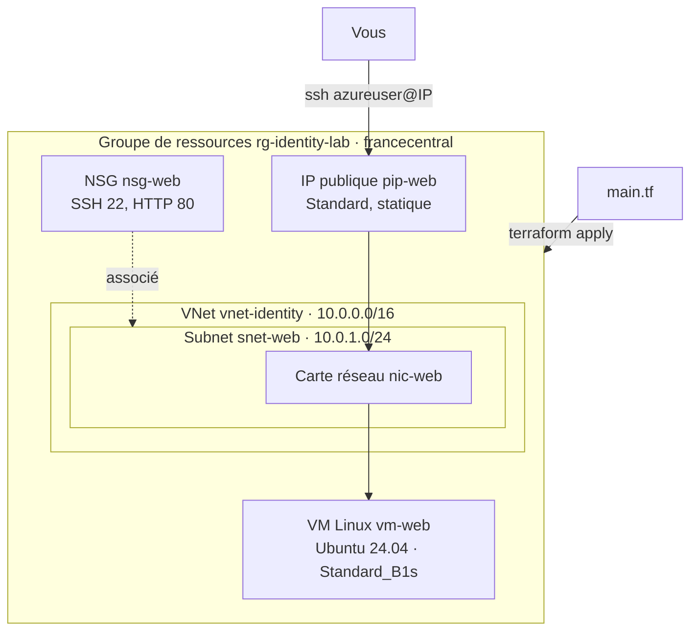

# Lab 02 — Première infrastructure Azure

> **Durée :** 60 min · **Jour 1** · **Adapté de :** Lab 2 *Première ressource AWS*

## Objectif

Écrire sa première configuration Terraform en HCL et maîtriser le cycle de vie **`init` → `plan` → `apply`** :

- déclarer le provider `azurerm` ;
- créer un groupe de ressources, puis une machine virtuelle Linux avec son réseau (sur Azure, une VM a besoin d'un VNet, d'un subnet, d'une carte réseau et d'une IP publique) ;
- modifier la configuration et observer une **mise à jour sur place** (`~ update in-place`).

Ce projet est le **fil rouge** des labs 02 à 09.

## Schéma de l'objectif



---

## Tâche 1 : générer votre première configuration

Le code Terraform est écrit en **HCL** dans des fichiers `.tf`. HCL est déclaratif : on décrit l'état souhaité, Terraform calcule comment y arriver.

> Installez l'extension VS Code **HashiCorp Terraform** (`hashicorp.terraform`) pour la coloration, l'autocomplétion et la validation.

### Étape 1.1 : le provider

```bash
mkdir -p ~/terraform-azure/terraform && cd ~/terraform-azure/terraform
```

Créez `main.tf` :

```hcl
terraform {
  required_version = ">= 1.9"

  required_providers {
    azurerm = {
      source  = "hashicorp/azurerm"
      version = "~> 4.0"
    }
  }
}

provider "azurerm" {
  features {}
  subscription_id = "<SUBSCRIPTION_ID>"   # obligatoire depuis azurerm 4.x (ou ARM_SUBSCRIPTION_ID)
}
```

- `required_providers` fixe la source et la version du provider (bonne pratique).
- Le bloc `features {}` est **obligatoire** pour `azurerm`, même vide.
- Les identifiants viennent de `az login` ou des variables `ARM_*` du lab 01 : **aucun secret dans le code**, contrairement à `access_key`/`secret_key` des labs AWS d'origine.

### Étape 1.2 : la première ressource

Ajoutez à `main.tf` :

```hcl
resource "azurerm_resource_group" "rg" {
  name     = "rg-<identity>-lab"
  location = "francecentral"
}
```

Syntaxe générale d'une ressource :

```hcl
resource "<PROVIDER>_<TYPE>" "<NOM_LOCAL>" {
  [CONFIG …]
}
```

- **PROVIDER** : `azurerm` ;
- **TYPE** : `resource_group` ;
- **NOM_LOCAL** : `rg`, identifiant interne utilisé pour référencer la ressource (`azurerm_resource_group.rg`) ;
- **CONFIG** : arguments propres au type de ressource.

---

## Tâche 2 : utiliser la CLI Terraform pour obtenir de l'aide

```bash
terraform -help
terraform -help plan     # ou : terraform plan -h
```

### Initialiser le projet

```bash
terraform init
```

`init` lit le code, détermine les providers nécessaires et les télécharge dans `.terraform/`. Le fichier `.terraform.lock.hcl` verrouille les versions exactes : **il doit être versionné**.

### Planifier

```bash
terraform plan
```

```text
  # azurerm_resource_group.rg will be created
  + resource "azurerm_resource_group" "rg" {
      + id       = (known after apply)
      + location = "francecentral"
      + name     = "rg-student01-lab"
    }

Plan: 1 to add, 0 to change, 0 to destroy.
```

### Appliquer

```bash
terraform apply     # répondre "yes"
```

Vérifiez dans le portail Azure ou avec :

```bash
az group show --name rg-<identity>-lab -o table
```

---

## Tâche 3 : ajouter le réseau et la machine virtuelle

Sur AWS, une instance EC2 pouvait utiliser le VPC et le security group par défaut. Sur Azure, **il n'y a pas de réseau par défaut** : il faut le déclarer. Ajoutez à `main.tf` :

```hcl
resource "azurerm_virtual_network" "vnet" {
  name                = "vnet-<identity>"
  address_space       = ["10.0.0.0/16"]
  location            = azurerm_resource_group.rg.location
  resource_group_name = azurerm_resource_group.rg.name
}

resource "azurerm_subnet" "web" {
  name                 = "snet-web"
  resource_group_name  = azurerm_resource_group.rg.name
  virtual_network_name = azurerm_virtual_network.vnet.name
  address_prefixes     = ["10.0.1.0/24"]
}

resource "azurerm_network_security_group" "web" {
  name                = "nsg-web"
  location            = azurerm_resource_group.rg.location
  resource_group_name = azurerm_resource_group.rg.name

  security_rule {
    name                       = "Allow-SSH"
    priority                   = 100
    direction                  = "Inbound"
    access                     = "Allow"
    protocol                   = "Tcp"
    source_port_range          = "*"
    destination_port_range     = "22"
    source_address_prefix      = "*"
    destination_address_prefix = "*"
  }

  security_rule {
    name                       = "Allow-HTTP"
    priority                   = 110
    direction                  = "Inbound"
    access                     = "Allow"
    protocol                   = "Tcp"
    source_port_range          = "*"
    destination_port_range     = "80"
    source_address_prefix      = "*"
    destination_address_prefix = "*"
  }
}

resource "azurerm_subnet_network_security_group_association" "web" {
  subnet_id                 = azurerm_subnet.web.id
  network_security_group_id = azurerm_network_security_group.web.id
}

resource "azurerm_public_ip" "web" {
  name                = "pip-web"
  location            = azurerm_resource_group.rg.location
  resource_group_name = azurerm_resource_group.rg.name
  allocation_method   = "Static"
  sku                 = "Standard"
  domain_name_label   = "<identity>-web"   # unique dans la région
}

resource "azurerm_network_interface" "web" {
  name                = "nic-web"
  location            = azurerm_resource_group.rg.location
  resource_group_name = azurerm_resource_group.rg.name

  ip_configuration {
    name                          = "internal"
    subnet_id                     = azurerm_subnet.web.id
    private_ip_address_allocation = "Dynamic"
    public_ip_address_id          = azurerm_public_ip.web.id
  }
}

resource "azurerm_linux_virtual_machine" "web" {
  name                  = "vm-web"
  location              = azurerm_resource_group.rg.location
  resource_group_name   = azurerm_resource_group.rg.name
  size                  = "Standard_B1s"
  admin_username        = "azureuser"
  network_interface_ids = [azurerm_network_interface.web.id]

  admin_ssh_key {
    username   = "azureuser"
    public_key = file("~/.ssh/id_rsa.pub")
  }

  os_disk {
    caching              = "ReadWrite"
    storage_account_type = "Standard_LRS"
  }

  source_image_reference {
    publisher = "Canonical"
    offer     = "ubuntu-24_04-lts"
    sku       = "server"
    version   = "latest"
  }
}
```

**Points à observer :**

- Les références comme `azurerm_resource_group.rg.name` créent des **dépendances implicites** : Terraform construit le graphe et crée les ressources dans le bon ordre, en parallèle quand c'est possible.
- `source_image_reference` joue le rôle de l'**AMI** sur AWS.
- `Standard_B1s` (1 vCPU, 1 Go) joue le rôle du `t2.micro`.
- Une IP publique **Standard** bloque tout trafic entrant tant qu'un NSG ne l'autorise pas.

```bash
terraform plan     # 8 to add
terraform apply
```

Récupérez l'adresse IP et testez la connexion :

```bash
terraform show | grep ip_address
ssh azureuser@<IP_PUBLIQUE>
```

---

## Tâche 4 : mettre à jour la configuration

Terraform sait modifier une ressource existante sans la recréer quand l'argument le permet. Ajoutez un bloc `tags` à la VM :

```hcl
resource "azurerm_linux_virtual_machine" "web" {
  # ... arguments existants inchangés ...

  tags = {
    Identity    = "<identity>"
    Name        = "Web"
    Environment = "Training"
  }
}
```

```bash
terraform apply
```

```text
  # azurerm_linux_virtual_machine.web will be updated in-place
  ~ resource "azurerm_linux_virtual_machine" "web" {
      ~ tags = {
          + "Environment" = "Training"
          + "Identity"    = "student01"
          + "Name"        = "Web"
        }
    }

Plan: 0 to add, 1 to change, 0 to destroy.
```

**Expérience :** changez `size = "Standard_B1s"` en `"Standard_B1ms"` et lancez `terraform plan`. La VM est redimensionnée sur place (redémarrage). Changez ensuite `admin_username` : le plan indique **`-/+ must be replaced`**. Revenez aux valeurs initiales avant de continuer.

| Symbole | Signification |
|---|---|
| `+` | création |
| `~` | modification sur place |
| `-/+` | destruction puis recréation (argument `forces replacement`) |
| `-` | destruction |

---

## Vérification

- [ ] `terraform state list` affiche 8 ressources.
- [ ] Vous pouvez vous connecter en SSH à la VM.
- [ ] Les tags apparaissent sur la VM dans le portail Azure.

> **Gardez cette infrastructure** : elle est réutilisée dans les labs suivants.
