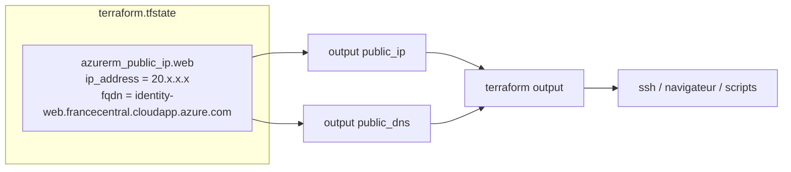

# Lab 03 — Les outputs

> **Durée :** 20 min · **Jour 1** · **Adapté de :** Lab 3 *Outputs*

## Objectif

Exposer des valeurs précises de l'infrastructure (IP publique, nom DNS) avec des blocs `output`, plutôt que de les chercher dans la sortie de `terraform show`. Les outputs servent aussi à **transmettre des valeurs** entre modules (lab 05) et entre projets (labs 10 et 11).

## Schéma de l'objectif



---

## Tâche 1 : créer des outputs

Dans le répertoire `~/terraform-azure/terraform`, créez un fichier `outputs.tf` :

```hcl
output "public_ip" {
  description = "Adresse IP publique du serveur web"
  value       = azurerm_public_ip.web.ip_address
}

output "public_dns" {
  description = "Nom DNS public du serveur web"
  value       = azurerm_public_ip.web.fqdn
}
```

> Sur AWS, ces attributs étaient portés par l'instance (`aws_instance.web.public_ip`). Sur Azure, ils sont portés par la ressource **IP publique**. La VM expose aussi `azurerm_linux_virtual_machine.web.public_ip_address`.

### Étape 1.2 : mettre à jour l'état sans toucher l'infrastructure

```bash
terraform apply -refresh-only
```

> `terraform refresh`, utilisé dans le lab d'origine, est **déprécié**. `apply -refresh-only` affiche les écarts détectés et demande une confirmation avant d'écrire l'état.

Un simple `terraform apply` fonctionne aussi : ajouter un output ne modifie aucune ressource.

---

## Tâche 2 : interroger les outputs

```bash
# Tous les outputs
terraform output

# Un output précis
terraform output public_dns

# Valeur brute, sans guillemets (pratique dans un script)
terraform output -raw public_ip

# Format JSON (pour jq, la CI…)
terraform output -json
```

Utilisation directe dans une commande :

```bash
ssh azureuser@$(terraform output -raw public_ip)
```

---

## Exercice

1. Ajoutez un output `private_ip` avec l'adresse IP privée de la VM (attribut `private_ip_address` de la VM ou de la carte réseau).
2. Ajoutez un output `ssh_command` qui affiche la commande SSH complète, en utilisant l'interpolation de chaîne :

```hcl
output "ssh_command" {
  value = "ssh azureuser@${azurerm_public_ip.web.ip_address}"
}
```

3. Ajoutez `sensitive = true` à un output et observez son affichage avec `terraform output`, puis avec `terraform output -raw <nom>`.

## Vérification

- [ ] `terraform output` affiche `public_ip`, `public_dns`, `private_ip` et `ssh_command`.
- [ ] La commande `ssh $(terraform output -raw ...)` fonctionne.
