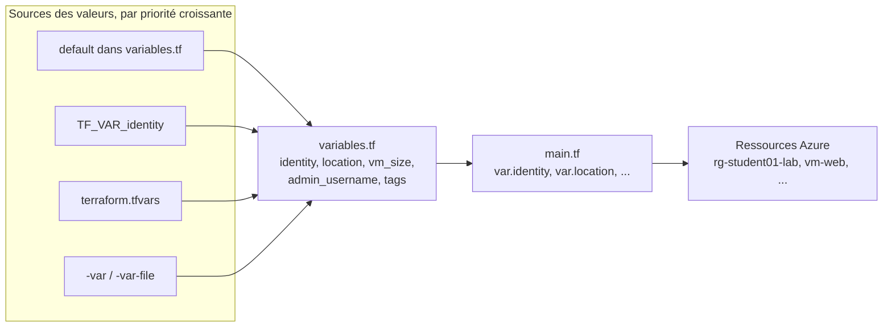

# Lab 04 — Les variables

> **Durée :** 50 min · **Jour 1** · **Adapté de :** Lab 4 *Les variables*

## Objectif

Supprimer les valeurs codées en dur dans `main.tf` pour rendre la configuration **réutilisable** :

- déclarer des variables d'entrée (`variable`) avec type, description et valeur par défaut ;
- les utiliser dans le code (`var.nom`) ;
- fournir les valeurs avec `terraform.tfvars`, la ligne de commande ou des variables d'environnement ;
- utiliser des types complexes (`list`, `map`) et la fonction `lookup`.

## Schéma de l'objectif



---

## Tâche 1 : déclarer les variables

Dans `~/terraform-azure/terraform`, créez `variables.tf` :

```hcl
variable "subscription_id" {
  description = "ID de l'abonnement Azure"
  type        = string
}

variable "identity" {
  description = "Identifiant unique du participant (minuscules, sans espace)"
  type        = string
}

variable "location" {
  description = "Région Azure"
  type        = string
  default     = "francecentral"
}

variable "vm_size" {
  description = "Taille de la machine virtuelle"
  type        = string
  default     = "Standard_B1s"
}

variable "admin_username" {
  description = "Utilisateur administrateur de la VM"
  type        = string
  default     = "azureuser"
}

variable "address_space" {
  description = "Plage d'adresses du VNet"
  type        = list(string)
  default     = ["10.0.0.0/16"]
}

variable "tags" {
  description = "Tags communs à toutes les ressources"
  type        = map(string)
  default = {
    Environment = "Training"
  }
}
```

Une variable sans `default` est **obligatoire** : Terraform la demandera si aucune valeur n'est fournie.

---

## Tâche 2 : utiliser les variables dans le code

### Étape 2.1 : le provider

```hcl
provider "azurerm" {
  features {}
  subscription_id = var.subscription_id
}
```

### Étape 2.2 : les ressources

Remplacez les valeurs en dur. Exemples :

```hcl
resource "azurerm_resource_group" "rg" {
  name     = "rg-${var.identity}-lab"
  location = var.location
  tags     = var.tags
}

resource "azurerm_virtual_network" "vnet" {
  name                = "vnet-${var.identity}"
  address_space       = var.address_space
  location            = azurerm_resource_group.rg.location
  resource_group_name = azurerm_resource_group.rg.name
}

resource "azurerm_public_ip" "web" {
  # ...
  domain_name_label = "${var.identity}-web"
}

resource "azurerm_linux_virtual_machine" "web" {
  name                  = "vm-web"
  location              = azurerm_resource_group.rg.location
  resource_group_name   = azurerm_resource_group.rg.name
  size                  = var.vm_size
  admin_username        = var.admin_username
  network_interface_ids = [azurerm_network_interface.web.id]

  admin_ssh_key {
    username   = var.admin_username
    public_key = file("~/.ssh/id_rsa.pub")
  }

  # os_disk et source_image_reference inchangés

  tags = merge(var.tags, {
    Identity = var.identity
    Name     = "Student"
  })
}
```

> `merge()` combine les tags communs et les tags propres à la ressource.

### Étape 2.3 : observer la saisie interactive

```bash
terraform plan
```

```text
var.identity
  Identifiant unique du participant (minuscules, sans espace)

  Enter a value:
```

Quittez avec `Ctrl+C`.

---

## Tâche 3 : le fichier `terraform.tfvars`

### Étape 3.1

Créez `terraform.tfvars` :

```hcl
subscription_id = "<SUBSCRIPTION_ID>"
identity        = "<identity>"
```

```bash
terraform plan
```

Résultat attendu :

```text
No changes. Your infrastructure matches the configuration.
```

C'est normal : les variables contiennent les mêmes valeurs que celles codées auparavant.

### Étape 3.2 : les autres façons de passer une valeur

```bash
# En ligne de commande
terraform plan -var="vm_size=Standard_B1ms"

# Par variable d'environnement (préfixe TF_VAR_)
export TF_VAR_identity="<identity>"

# Par un fichier dédié
terraform plan -var-file="dev.tfvars"
```

> **Sécurité :** `terraform.tfvars` est souvent versionné. N'y mettez **jamais** de secret (client secret, mot de passe). Utilisez les variables d'environnement `ARM_*` ou un coffre comme Azure Key Vault.

### Étape 3.3 : valider une variable

Ajoutez une règle de validation sur `location` :

```hcl
variable "location" {
  type    = string
  default = "francecentral"

  validation {
    condition     = contains(["francecentral", "westeurope", "northeurope"], var.location)
    error_message = "Région non autorisée pour la formation."
  }
}
```

Testez avec `terraform plan -var="location=eastus"`.

---

## Exercice : découper un projet et utiliser `lookup`

On part d'un projet tout‑en‑un. Créez un répertoire `~/terraform-azure/lab04-exercice` contenant ce `instance.tf` :

```hcl
provider "azurerm" {
  features {}
  subscription_id = "<SUBSCRIPTION_ID>"
}

resource "azurerm_resource_group" "example" {
  name     = "rg-<identity>-exercice"
  location = "francecentral"
}
```

### 1. Découpez‑le en quatre fichiers

- **`provider.tf`** : uniquement le provider, qui référence des variables.

```hcl
provider "azurerm" {
  features {}
  subscription_id = var.ARM_SUBSCRIPTION_ID
}
```

- **`vars.tf`** : la déclaration des variables.

```hcl
variable "ARM_SUBSCRIPTION_ID" {}
variable "IDENTITY" {}
variable "LOCATION" {
  default = "francecentral"
}
variable "ENV" {
  default = "dev"
}
```

Si les accolades sont vides, la variable n'a pas de valeur par défaut. Avec `default`, on fixe une valeur par défaut.

- **`terraform.tfvars`** : les valeurs.

```hcl
ARM_SUBSCRIPTION_ID = "<SUBSCRIPTION_ID>"
IDENTITY            = "<identity>"
```

- **`instance.tf`** : les ressources (groupe de ressources, réseau et VM, sur le modèle du lab 02).

### 2. Déployez l'infrastructure

### 3. Choisir la taille de VM selon l'environnement

Sur AWS, l'ID d'AMI change selon la région, d'où une map `AMIS`. Sur Azure, une image est identifiée de la même façon dans toutes les régions ; on illustre donc `lookup` avec une **taille de VM par environnement**.

a. Dans `vars.tf`, déclarez une map :

```hcl
variable "VM_SIZES" {
  type = map(string)
  default = {
    dev  = "Standard_B1s"
    test = "Standard_B1ms"
    prod = "Standard_B2s"
  }
}
```

b. Dans `instance.tf`, récupérez la taille selon l'environnement avec `lookup` :

```hcl
size = lookup(var.VM_SIZES, var.ENV, "Standard_B1s") # le 3e paramètre est la valeur par défaut
```

c. Testez : `terraform plan -var="ENV=prod"`.

### 4. Bonus : une map d'objets pour l'image

```hcl
variable "IMAGES" {
  type = map(object({
    publisher = string
    offer     = string
    sku       = string
  }))
  default = {
    ubuntu2404 = { publisher = "Canonical", offer = "ubuntu-24_04-lts", sku = "server" }
    ubuntu2204 = { publisher = "Canonical", offer = "0001-com-ubuntu-server-jammy", sku = "22_04-lts-gen2" }
    debian12   = { publisher = "Debian", offer = "debian-12", sku = "12-gen2" }
  }
}

variable "OS" {
  default = "ubuntu2404"
}
```

```hcl
source_image_reference {
  publisher = var.IMAGES[var.OS].publisher
  offer     = var.IMAGES[var.OS].offer
  sku       = var.IMAGES[var.OS].sku
  version   = "latest"
}
```

> Conservez ce répertoire : il est réutilisé dans l'exercice du lab 06. Pensez à `terraform destroy` en fin de journée.

## Vérification

- [ ] Plus aucune valeur propre au participant n'est codée en dur dans `main.tf`.
- [ ] `terraform plan` sur le fil rouge indique **No changes**.
- [ ] `terraform plan -var="ENV=prod"` dans l'exercice propose `Standard_B2s`.
