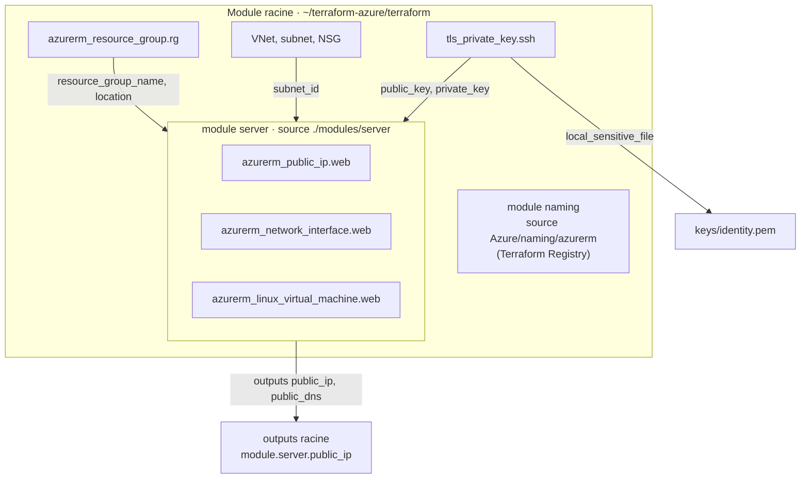

# Lab 05 — Les modules

> **Durée :** 60 min · **Jour 1** · **Adapté de :** Lab 5 *Les Modules*

## Objectif

Organiser le code en **modules réutilisables** :

- refactoriser la VM du fil rouge (IP publique, carte réseau, VM) dans un module local `server` ;
- déplacer des ressources dans un module **sans les recréer**, grâce aux blocs `moved` ;
- explorer le **Terraform Registry** et consommer un module public (`Azure/naming/azurerm`) ;
- générer une paire de clés SSH et la transmettre au module `server` par ses variables d'entrée.

## Schéma de l'objectif



---

## Tâche 1 : refactoriser le code dans un module local

Un module Terraform est simplement **un répertoire de fichiers `.tf`**. Le répertoire où l'on lance `terraform` est le **module racine**.

### Étape 1.1 : créer l'arborescence

```bash
cd ~/terraform-azure/terraform
mkdir -p modules/server
touch modules/server/{main.tf,variables.tf,outputs.tf}
```

```text
terraform/
├── main.tf
├── variables.tf
├── outputs.tf
├── terraform.tfvars
└── modules/
    └── server/
        ├── main.tf
        ├── variables.tf
        └── outputs.tf
```

### Étape 1.2 : les variables du module

`modules/server/variables.tf` :

```hcl
variable "identity" {
  type = string
}

variable "location" {
  type = string
}

variable "resource_group_name" {
  type = string
}

variable "subnet_id" {
  type = string
}

variable "vm_size" {
  type    = string
  default = "Standard_B1s"
}

variable "admin_username" {
  type    = string
  default = "azureuser"
}

variable "public_key" {
  description = "Clé publique SSH au format OpenSSH"
  type        = string
}

variable "tags" {
  type    = map(string)
  default = {}
}
```

### Étape 1.3 : les ressources du module

**Déplacez** (couper‑coller) les ressources `azurerm_public_ip.web`, `azurerm_network_interface.web` et `azurerm_linux_virtual_machine.web` de `main.tf` vers `modules/server/main.tf`, puis adaptez les références :

```hcl
resource "azurerm_public_ip" "web" {
  name                = "pip-web"
  location            = var.location
  resource_group_name = var.resource_group_name
  allocation_method   = "Static"
  sku                 = "Standard"
  domain_name_label   = "${var.identity}-web"
}

resource "azurerm_network_interface" "web" {
  name                = "nic-web"
  location            = var.location
  resource_group_name = var.resource_group_name

  ip_configuration {
    name                          = "internal"
    subnet_id                     = var.subnet_id
    private_ip_address_allocation = "Dynamic"
    public_ip_address_id          = azurerm_public_ip.web.id
  }
}

resource "azurerm_linux_virtual_machine" "web" {
  name                  = "vm-web"
  location              = var.location
  resource_group_name   = var.resource_group_name
  size                  = var.vm_size
  admin_username        = var.admin_username
  network_interface_ids = [azurerm_network_interface.web.id]

  admin_ssh_key {
    username   = var.admin_username
    public_key = var.public_key
  }

  os_disk {
    caching              = "ReadWrite"
    storage_account_type = "Standard_LRS"
  }

  source_image_reference {
    publisher = "Canonical"
    offer     = "ubuntu-24_04-lts"
    sku       = "server"
    version   = "latest"
  }

  tags = merge(var.tags, {
    Identity = var.identity
    Name     = "Student"
  })
}
```

### Étape 1.4 : les outputs du module

`modules/server/outputs.tf` :

```hcl
output "public_ip" {
  value = azurerm_public_ip.web.ip_address
}

output "public_dns" {
  value = azurerm_public_ip.web.fqdn
}
```

### Étape 1.5 : appeler le module depuis la racine

Dans `main.tf` (racine), à la place des trois ressources supprimées :

```hcl
module "server" {
  source = "./modules/server"

  identity            = var.identity
  location            = azurerm_resource_group.rg.location
  resource_group_name = azurerm_resource_group.rg.name
  subnet_id           = azurerm_subnet.web.id
  vm_size             = var.vm_size
  admin_username      = var.admin_username
  public_key          = file("~/.ssh/id_rsa.pub")
  tags                = var.tags
}
```

Dans `outputs.tf` (racine), les outputs lisent désormais le module :

```hcl
output "public_ip" {
  value = module.server.public_ip
}

output "public_dns" {
  value = module.server.public_dns
}
```

Supprimez les autres outputs qui référençaient directement la VM ou la NIC (ou faites‑les passer par le module).

### Étape 1.6 : installer le module et observer le plan

Même un module local doit être installé :

```bash
terraform init      # ou terraform get
terraform plan
```

```text
  # azurerm_linux_virtual_machine.web will be destroyed
  # module.server.azurerm_linux_virtual_machine.web will be created
  ...
Plan: 3 to add, 0 to change, 3 to destroy.
```

Terraform voit des ressources **différentes** (leur adresse a changé) et veut les recréer. **N'appliquez pas !**

### Étape 1.7 : déplacer sans recréer avec `moved`

Ajoutez dans `main.tf` (racine) :

```hcl
moved {
  from = azurerm_public_ip.web
  to   = module.server.azurerm_public_ip.web
}

moved {
  from = azurerm_network_interface.web
  to   = module.server.azurerm_network_interface.web
}

moved {
  from = azurerm_linux_virtual_machine.web
  to   = module.server.azurerm_linux_virtual_machine.web
}
```

```bash
terraform plan
```

```text
  # azurerm_linux_virtual_machine.web has moved to module.server.azurerm_linux_virtual_machine.web
...
Plan: 0 to add, 0 to change, 0 to destroy.
```

```bash
terraform apply
```

> Les blocs `moved` (Terraform ≥ 1.1) remplacent avantageusement `terraform state mv`, car le déplacement est **versionné avec le code**. On peut les supprimer une fois que tous les environnements ont été appliqués.

---

## Tâche 2 : explorer le registre public des modules

### Étape 2.1

Ouvrez <https://registry.terraform.io/> et filtrez sur le provider **azurerm**. Repérez :

- les modules **Azure Verified Modules** (préfixe `Azure/avm-res-…`), maintenus par Microsoft ;
- le module **`Azure/naming/azurerm`**, qui génère des noms conformes aux règles de nommage Azure (longueur, caractères autorisés, unicité).

Pour chaque module, lisez les onglets **Readme**, **Inputs**, **Outputs** et **Resources**.

### Étape 2.2 : utiliser le module `naming`

Ajoutez dans `main.tf` :

```hcl
module "naming" {
  source  = "Azure/naming/azurerm"
  version = "~> 0.4"      # vérifiez la dernière version sur le registre

  suffix = [var.identity]
}

output "noms_recommandes" {
  value = {
    resource_group  = module.naming.resource_group.name
    virtual_network = module.naming.virtual_network.name
    storage_account = module.naming.storage_account.name_unique
  }
}
```

```bash
terraform init      # télécharge le module dans .terraform/modules
terraform apply
```

> Ce module ne crée aucune ressource Azure : il ne fait que calculer des noms. On l'utilisera pour les nouveaux projets ; renommer les ressources existantes provoquerait leur recréation.

---

## Tâche 3 : générer une clé SSH et la passer au module

Dans le lab d'origine, un module générait une paire de clés. Ici, on utilise le provider **`tls`** et on transmet le résultat au module `server`.

### Étape 3.1 : déclarer les providers

Dans le bloc `terraform { required_providers { ... } }` de `main.tf` :

```hcl
    tls = {
      source  = "hashicorp/tls"
      version = "~> 4.0"
    }
    local = {
      source  = "hashicorp/local"
      version = "~> 2.5"
    }
```

### Étape 3.2 : générer la clé

```hcl
resource "tls_private_key" "ssh" {
  algorithm = "RSA"
  rsa_bits  = 4096
}

resource "local_sensitive_file" "private_key" {
  content         = tls_private_key.ssh.private_key_pem
  filename        = "${path.root}/keys/${var.identity}.pem"
  file_permission = "0600"
}
```

> **Attention :** la clé privée est stockée en clair dans le fichier d'état. Cette méthode est pratique en formation mais **ne doit pas être utilisée en production** (on y préfère Azure Key Vault ou une clé générée hors de Terraform).

### Étape 3.3 : passer la clé au module

Dans `modules/server/variables.tf`, ajoutez :

```hcl
variable "private_key" {
  description = "Clé privée SSH, utilisée par les provisioners au lab 06"
  type        = string
  sensitive   = true
}
```

Dans l'appel du module (`main.tf` racine) :

```hcl
module "server" {
  source = "./modules/server"
  # ... arguments existants ...
  public_key  = tls_private_key.ssh.public_key_openssh
  private_key = tls_private_key.ssh.private_key_pem
}
```

La variable `private_key` sera utilisée au lab suivant.

---

## Tâche 4 : appliquer et observer

```bash
terraform init
terraform apply
```

La clé publique d'une VM Azure ne peut pas être modifiée sur place : le plan indique **`-/+ must be replaced`** pour `module.server.azurerm_linux_virtual_machine.web`. Confirmez.

Connectez‑vous avec la nouvelle clé :

```bash
ssh -i keys/<identity>.pem azureuser@$(terraform output -raw public_ip)
```

Ajoutez `keys/` à votre `.gitignore`.

## Vérification

- [ ] `terraform state list` affiche les ressources préfixées par `module.server.`.
- [ ] Le refactoring avec `moved` s'est fait sans destruction.
- [ ] La connexion SSH fonctionne avec `keys/<identity>.pem`.
