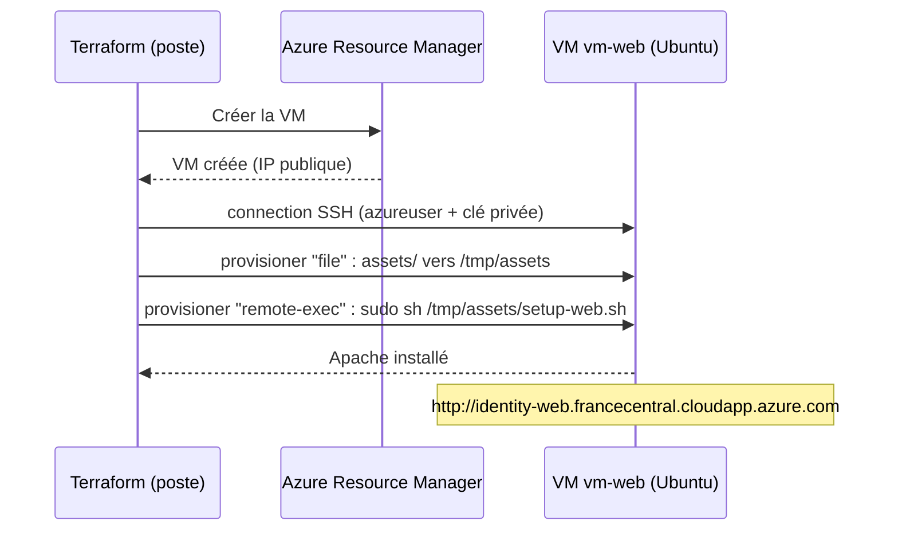

# Lab 06 — Provisioners

> **Durée :** 45 min · **Jour 1** · **Adapté de :** Lab 6 *Provisioners*

## Objectif

Configurer la VM **après sa création** :

- définir un bloc `connection` SSH à partir de la clé générée au lab 05 ;
- copier des fichiers avec le provisioner `file` et exécuter des commandes avec `remote-exec` ;
- comprendre que les provisioners ne s'exécutent **qu'à la création**, et forcer une recréation avec `terraform apply -replace` ;
- comparer avec l'approche recommandée sur Azure : `custom_data` (cloud-init).

## Schéma de l'objectif



---

## Tâche 1 : créer un bloc de connexion

### Étape 1.1

Dans `modules/server/main.tf`, ajoutez un bloc `connection` dans la ressource `azurerm_linux_virtual_machine.web`, sous les tags :

```hcl
resource "azurerm_linux_virtual_machine" "web" {
  # ... début du bloc inchangé ...

  connection {
    type        = "ssh"
    user        = var.admin_username
    private_key = var.private_key
    host        = self.public_ip_address
  }
}
```

- La variable `private_key` a été ajoutée au lab précédent.
- `self` désigne la ressource en cours de définition : `self.public_ip_address` est l'IP publique de **cette** VM.

---

## Tâche 2 : copier et exécuter un script

### Étape 2.1 : provisioner `file`

Il s'exécute après la création de la VM et copie le répertoire `assets`. Ajoutez‑le après le bloc `connection` :

```hcl
  provisioner "file" {
    source      = "${path.root}/assets"
    destination = "/tmp/"
  }
```

### Étape 2.2 : provisioner `remote-exec`

Ajoutez‑le après le provisioner `file` :

```hcl
  provisioner "remote-exec" {
    inline = [
      "cloud-init status --wait > /dev/null",   # attendre la fin du démarrage (verrou apt)
      "sudo sh /tmp/assets/setup-web.sh",
    ]
  }
```

Les deux provisioners doivent se trouver **dans** le bloc `azurerm_linux_virtual_machine`.

### Étape 2.3 : le script

Créez `assets/setup-web.sh` à la racine du projet :

```bash
#!/bin/bash
apt-get update
apt-get install -y apache2
systemctl start apache2
systemctl enable apache2
echo "<html><h1>Bienvenue sur Apache, déployé par Terraform sur Azure</h1><p>$(hostname)</p></html>" > /var/www/html/index.html
```

---

## Tâche 3 : appliquer et observer la connexion distante

### Étape 3.1 : les provisioners ne déclenchent rien seuls

```bash
terraform apply
```

```text
Apply complete! Resources: 0 added, 0 changed, 0 destroyed.
```

Ajouter ou retirer un provisioner **ne modifie pas** la ressource : Terraform ne recrée pas la VM.

### Étape 3.2 : forcer la recréation

Le lab d'origine utilisait `terraform taint`, aujourd'hui déprécié. On utilise `-replace` :

```bash
terraform apply -replace="module.server.azurerm_linux_virtual_machine.web"
```

```text
module.server.azurerm_linux_virtual_machine.web: Provisioning with 'file'...
module.server.azurerm_linux_virtual_machine.web: Provisioning with 'remote-exec'...
module.server.azurerm_linux_virtual_machine.web (remote-exec): Connecting to remote host via SSH...
module.server.azurerm_linux_virtual_machine.web (remote-exec):   Host: 20.x.x.x
module.server.azurerm_linux_virtual_machine.web (remote-exec):   User: azureuser
module.server.azurerm_linux_virtual_machine.web (remote-exec):   Private key: true
module.server.azurerm_linux_virtual_machine.web (remote-exec): Connected!
...
Apply complete! Resources: 1 added, 0 changed, 1 destroyed.
```

### Étape 3.3 : tester

```bash
curl http://$(terraform output -raw public_dns)
```

Ou ouvrez l'URL dans un navigateur. Vous pouvez aussi vous connecter :

```bash
ssh -i keys/<identity>.pem azureuser@$(terraform output -raw public_dns)
```

> Si un provisioner échoue, la ressource est marquée **tainted** et sera recréée au prochain `apply`.

---

## Exercice : provisioning avec une clé fournie et Nginx

Travaillez dans `~/terraform-azure/lab04-exercice`.

1. Créez une paire de clés SSH :

```bash
ssh-keygen -t rsa -b 4096 -f mykey -N ""
```

2. Ajoutez des variables dans `vars.tf` :

```hcl
variable "PATH_TO_PRIVATE_KEY" {
  default = "mykey"
}
variable "PATH_TO_PUBLIC_KEY" {
  default = "mykey.pub"
}
variable "INSTANCE_USERNAME" {
  default = "azureuser"
}
```

3. Sur Azure, il n'y a pas d'équivalent obligatoire à `aws_key_pair` : la clé publique est passée directement à la VM.

```hcl
  admin_username = var.INSTANCE_USERNAME

  admin_ssh_key {
    username   = var.INSTANCE_USERNAME
    public_key = file(var.PATH_TO_PUBLIC_KEY)
  }
```

> Pour stocker la clé comme ressource Azure réutilisable, on peut utiliser `azurerm_ssh_public_key`.

4. Créez `script.sh` pour installer Nginx :

```bash
#!/bin/bash
# attendre la fin du démarrage de la VM
until [[ -f /var/lib/cloud/instance/boot-finished ]]; do
  sleep 1
done
# installer nginx
apt-get update
apt-get -y install nginx
# s'assurer que nginx est démarré
systemctl start nginx
```

5. Dans la ressource VM, ajoutez les provisioners et le bloc de connexion :

```hcl
  provisioner "file" {
    source      = "script.sh"
    destination = "/tmp/script.sh"
  }

  provisioner "remote-exec" {
    inline = [
      "chmod +x /tmp/script.sh",
      "sudo sed -i -e 's/\\r$//' /tmp/script.sh",   # supprimer les CR (fichiers édités sous Windows)
      "sudo /tmp/script.sh",
    ]
  }

  connection {
    host        = coalesce(self.public_ip_address, self.private_ip_address)
    type        = "ssh"
    user        = var.INSTANCE_USERNAME
    private_key = file(var.PATH_TO_PRIVATE_KEY)
  }
```

6. Vérifiez que le NSG autorise les ports 22 et 80, appliquez, puis ouvrez `http://<IP>`.

---

## Pour aller plus loin : `custom_data` (cloud-init)

HashiCorp recommande les provisioners **en dernier recours**. Sur Azure, on préfère passer le script au démarrage avec `custom_data` : aucune connexion SSH depuis Terraform n'est nécessaire.

```hcl
resource "azurerm_linux_virtual_machine" "web" {
  # ...
  custom_data = base64encode(file("${path.root}/assets/setup-web.sh"))
}
```

| | Provisioners | `custom_data` / cloud-init |
|---|---|---|
| Connexion SSH depuis Terraform | Obligatoire | Non |
| Port 22 ouvert | Oui | Non |
| Erreurs visibles dans Terraform | Oui | Non (logs dans la VM) |
| Recommandé en production | Non | Oui |

## Vérification

- [ ] La page Apache s'affiche à l'adresse `public_dns`.
- [ ] Vous savez expliquer pourquoi l'ajout d'un provisioner ne recrée pas la VM.
