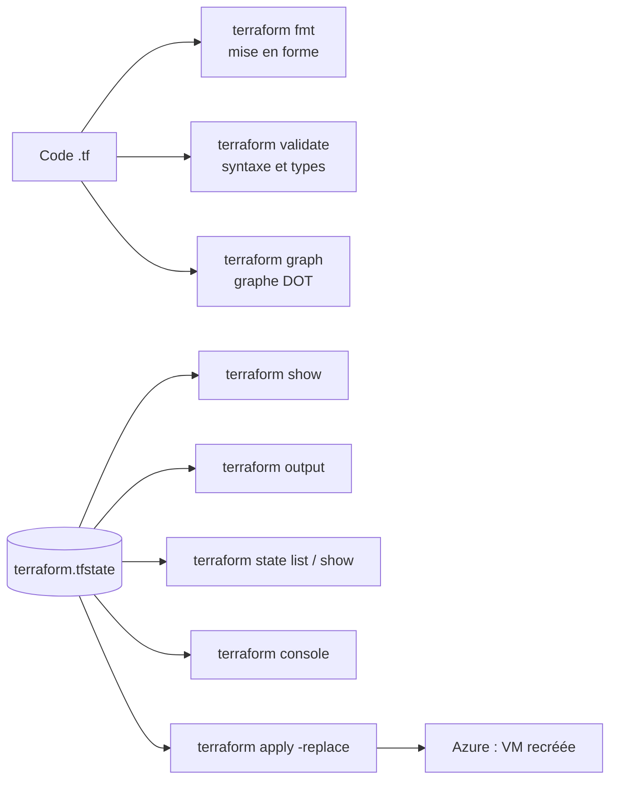

# Lab 07 — Les commandes Terraform

> **Durée :** 30 min · **Jour 1** · **Adapté de :** Lab 7 *Terraform Commands*

## Objectif

Maîtriser les commandes d'inspection et de maintenance du quotidien :

- `terraform console` pour évaluer des expressions sur l'état courant ;
- `terraform graph` pour visualiser le graphe de dépendances ;
- `terraform show`, `output`, `state list` et `state show` pour lire l'état ;
- `terraform apply -replace` pour reconstruire une ressource ;
- `terraform fmt` et `terraform validate` pour garder un code propre.

## Schéma de l'objectif



---

## Tâche 1 : la console Terraform

Les configurations utilisent sans cesse des expressions comme `azurerm_resource_group.rg.location`. La console les évalue sur l'état actuel.

### Étape 1.1

```bash
cd ~/terraform-azure/terraform
terraform console
```

```text
> azurerm_resource_group.rg.location
"francecentral"
> module.server.public_ip
"20.x.x.x"
> azurerm_subnet.web.address_prefixes
tolist([
  "10.0.1.0/24",
])
> cidrsubnet("10.0.0.0/16", 8, 2)
"10.0.2.0/24"
> upper(var.identity)
"STUDENT01"
```

Quittez avec `Ctrl+C` ou `exit`.

> La console est idéale pour **tester des fonctions** (`cidrsubnet`, `merge`, `lookup`, `format`…) avant de les écrire dans le code.

### Étape 1.2 : utiliser l'entrée standard

```bash
echo "azurerm_resource_group.rg.id" | terraform console
```

---

## Tâche 2 : le graphe de dépendances

### Étape 2.1

```bash
terraform graph
```

```text
digraph G {
  rankdir = "RL";
  node [shape = rect, fontname = "sans-serif"];
  "azurerm_resource_group.rg" [label="azurerm_resource_group.rg"];
  ...
}
```

### Étape 2.2 : le visualiser

Collez la sortie dans <https://dreampuf.github.io/GraphvizOnline/>, ou générez une image si Graphviz est installé :

```bash
sudo apt-get install -y graphviz
terraform graph | dot -Tsvg > graph.svg
```

Identifiez la chaîne de dépendances : groupe de ressources → VNet → subnet → module `server` (NIC → VM).

---

## Tâche 3 : afficher les informations de l'infrastructure

Le fichier `terraform.tfstate` est du JSON. Pour une lecture plus confortable :

```bash
terraform show
terraform show | grep ip_address
```

Lister et inspecter les ressources gérées :

```bash
terraform state list
terraform state show module.server.azurerm_linux_virtual_machine.web
```

---

## Tâche 4 : afficher les outputs

```bash
terraform output
terraform output -json
```

---

## Tâche 5 : marquer une ressource pour reconstruction

Si une VM est défaillante, `terraform plan` ne propose rien : la configuration correspond à l'état. Pour forcer sa recréation :

```bash
# Prévisualiser
terraform plan -replace="module.server.azurerm_linux_virtual_machine.web"

# Appliquer
terraform apply -replace="module.server.azurerm_linux_virtual_machine.web"
```

> `terraform taint <adresse>` existe toujours mais est **déprécié** : `-replace` montre l'effet dans le plan avant d'agir et ne modifie pas l'état à l'avance.

Testez l'erreur quand l'adresse est absente ou fausse :

```bash
terraform plan -replace="azurerm_linux_virtual_machine.web"
```

Le message indique que la ressource n'existe pas à cette adresse : depuis le lab 05, elle est dans `module.server`.

---

## Tâche 6 : formater et valider le code

```bash
# Réécrit les fichiers au format canonique (indentation de 2 espaces, alignement des =)
terraform fmt -recursive

# En CI : vérifier sans modifier (code retour ≠ 0 si un fichier est mal formaté)
terraform fmt -check -recursive

# Vérifier la cohérence syntaxique et les types
terraform validate
```

C'est un moyen simple de s'assurer que le formatage est correct avant de valider ses modifications dans Git.

## Vérification

- [ ] Vous savez retrouver l'IP de la VM de trois façons différentes (`console`, `show`, `output`).
- [ ] Vous avez généré et lu le graphe de dépendances.
- [ ] `terraform fmt -check -recursive` et `terraform validate` passent sans erreur.
