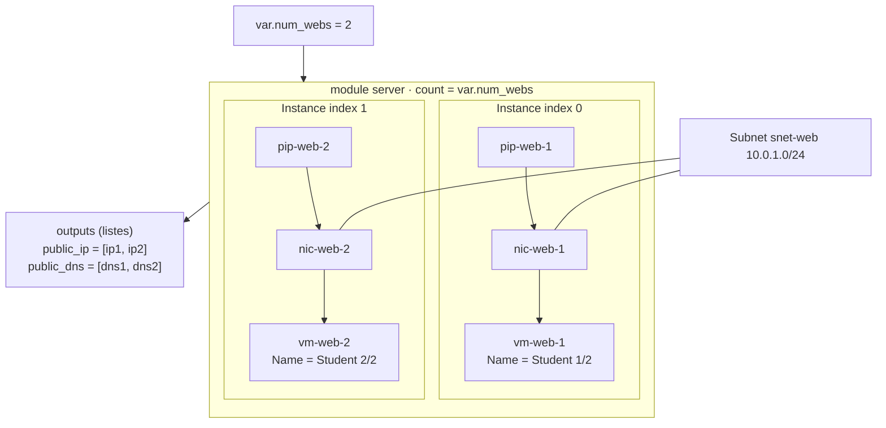

# Lab 08 — Les méta‑arguments

> **Durée :** 40 min · **Jour 1** · **Adapté de :** Lab 8 *Méta‑Arguments*

## Objectif

Utiliser les **méta‑arguments**, qui modifient la façon dont Terraform gère une ressource, quel que soit le provider :

- `count` pour créer plusieurs copies identiques (ici, plusieurs serveurs web) ;
- l'opérateur splat `[*]` pour référencer toutes les instances ;
- `count.index` pour personnaliser chaque copie ;
- en bonus, `for_each` pour des copies identifiées par une clé.

## Schéma de l'objectif



---

## Tâche 1 : créer plusieurs VM avec `count`

Sur AWS, il suffisait d'ajouter `count` à l'instance. Sur Azure, chaque VM a besoin de **sa propre** carte réseau et de **sa propre** IP publique : `count` s'applique donc aux trois ressources du module.

### Étape 1.1 : la variable

Dans `modules/server/variables.tf` :

```hcl
variable "num_webs" {
  description = "Nombre de serveurs web"
  type        = number
  default     = 2
}
```

### Étape 1.2 : appliquer `count` aux ressources

Dans `modules/server/main.tf` :

```hcl
resource "azurerm_public_ip" "web" {
  count               = var.num_webs
  name                = "pip-web-${count.index + 1}"
  location            = var.location
  resource_group_name = var.resource_group_name
  allocation_method   = "Static"
  sku                 = "Standard"
  domain_name_label   = "${var.identity}-web-${count.index + 1}"
}

resource "azurerm_network_interface" "web" {
  count               = var.num_webs
  name                = "nic-web-${count.index + 1}"
  location            = var.location
  resource_group_name = var.resource_group_name

  ip_configuration {
    name                          = "internal"
    subnet_id                     = var.subnet_id
    private_ip_address_allocation = "Dynamic"
    public_ip_address_id          = azurerm_public_ip.web[count.index].id
  }
}

resource "azurerm_linux_virtual_machine" "web" {
  count                 = var.num_webs
  name                  = "vm-web-${count.index + 1}"
  location              = var.location
  resource_group_name   = var.resource_group_name
  size                  = var.vm_size
  admin_username        = var.admin_username
  network_interface_ids = [azurerm_network_interface.web[count.index].id]

  # admin_ssh_key, os_disk, source_image_reference inchangés

  tags = merge(var.tags, {
    Identity = var.identity
    Name     = "Student ${count.index + 1}/${var.num_webs}"
  })

  # connection et provisioners du lab 06 inchangés (self fonctionne avec count)
}
```

- `count.index` commence à **0**, d'où le `+ 1` dans les noms.
- `azurerm_public_ip.web[count.index]` associe la NIC n à l'IP n.
- Le nom de la VM change (`vm-web` → `vm-web-1`), ce qui force sa recréation. C'est attendu dans ce lab.

---

## Tâche 2 : adapter les outputs

### Étape 2.1 : constater l'erreur

```bash
terraform plan
```

```text
Error: Missing resource instance key
  on modules/server/outputs.tf line 2, in output "public_ip":
   2:   value = azurerm_public_ip.web.ip_address
Because azurerm_public_ip.web has "count" set, its attributes must be accessed on specific instances.
```

Dès qu'une ressource a un `count`, elle représente **une liste** de ressources.

### Étape 2.2 : utiliser l'opérateur splat

`modules/server/outputs.tf` :

```hcl
output "public_ip" {
  value = azurerm_public_ip.web[*].ip_address
}

output "public_dns" {
  value = azurerm_public_ip.web[*].fqdn
}
```

> `[*]` est la forme moderne de l'ancienne syntaxe `.*.` (`aws_instance.web.*.public_ip`) du lab d'origine.

### Étape 2.3 : appliquer

```bash
terraform apply
```

```text
Outputs:

public_dns = [
  "student01-web-1.francecentral.cloudapp.azure.com",
  "student01-web-2.francecentral.cloudapp.azure.com",
]
public_ip = [
  "20.x.x.x",
  "20.y.y.y",
]
```

Ouvrez les deux URL : chaque page Apache affiche un nom d'hôte différent.

---

## Tâche 3 : piloter le nombre depuis la racine

Exposez `num_webs` dans l'appel du module (`main.tf` racine) :

```hcl
module "server" {
  source   = "./modules/server"
  num_webs = 3
  # ...
}
```

```bash
terraform plan     # 3 to add (pip, nic, vm de l'instance index 2)
terraform apply
```

Repassez ensuite à `2` et observez les ressources de l'index 2 détruites.

> **Piège de `count` :** si l'on retire un élément au milieu d'une liste, tous les éléments suivants changent d'index et sont recréés. D'où `for_each`.

---

## Pour aller plus loin : `for_each`

`for_each` identifie chaque copie par une **clé** stable plutôt que par un index. Exemple : des règles NSG générées à partir d'une map, avec un bloc `dynamic`.

```hcl
variable "inbound_ports" {
  type = map(number)
  default = {
    SSH   = 22
    HTTP  = 80
    HTTPS = 443
  }
}

resource "azurerm_network_security_group" "web" {
  name                = "nsg-web"
  location            = azurerm_resource_group.rg.location
  resource_group_name = azurerm_resource_group.rg.name

  dynamic "security_rule" {
    for_each = var.inbound_ports
    content {
      name                       = "Allow-${security_rule.key}"
      priority                   = 100 + index(keys(var.inbound_ports), security_rule.key) * 10
      direction                  = "Inbound"
      access                     = "Allow"
      protocol                   = "Tcp"
      source_port_range          = "*"
      destination_port_range     = tostring(security_rule.value)
      source_address_prefix      = "*"
      destination_address_prefix = "*"
    }
  }
}
```

Autres méta‑arguments à connaître : `depends_on` (dépendance explicite, utilisée au lab 14), `provider` (alias de provider) et `lifecycle` (`create_before_destroy`, `prevent_destroy`, `ignore_changes`).

## Vérification

- [ ] Deux VM `vm-web-1` et `vm-web-2` existent, avec les tags `Student 1/2` et `Student 2/2`.
- [ ] Les outputs sont des listes de deux éléments.
- [ ] Vous savez expliquer la différence entre `count` et `for_each`.
