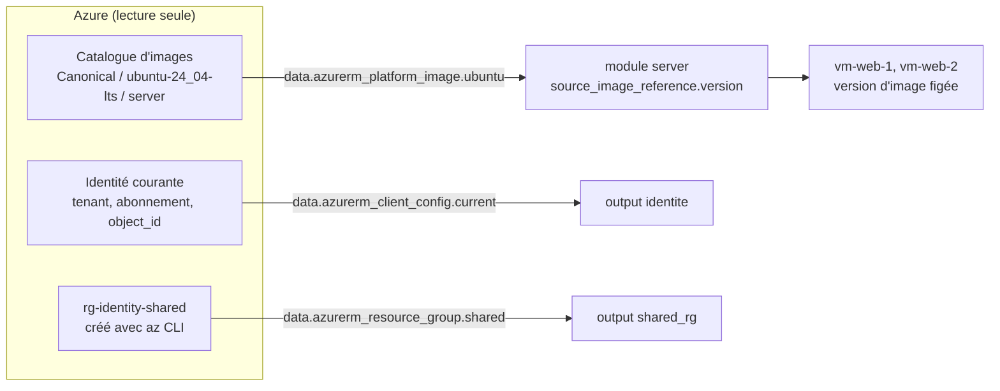

# Lab 09 — Les sources de données

> **Durée :** 30 min · **Jour 2** · **Adapté de :** Lab 9 *Source de données*

## Objectif

Lire des informations **existantes** dans Azure, sans les gérer, grâce aux blocs `data` :

- `azurerm_platform_image` pour trouver la dernière version de l'image Ubuntu 24.04 (équivalent de `data "aws_ami"`) ;
- `azurerm_client_config` pour connaître l'identité qui exécute Terraform ;
- `azurerm_resource_group` pour référencer une ressource créée hors de Terraform.

## Schéma de l'objectif



---

## Tâche 1 : la source de données d'image

### Étape 1.1

Dans `modules/server/main.tf`, après les variables, ajoutez :

```hcl
data "azurerm_platform_image" "ubuntu" {
  location  = var.location
  publisher = "Canonical"
  offer     = "ubuntu-24_04-lts"
  sku       = "server"
}
```

Sans argument `version`, Azure renvoie **la version la plus récente** de l'image, comme `most_recent = true` sur AWS.

Explorez ce qui est disponible avec l'Azure CLI :

```bash
az vm image list --publisher Canonical --offer ubuntu-24_04-lts --sku server --all -o table | tail -5
```

---

## Tâche 2 : utiliser l'image renvoyée

### Étape 2.1

Modifiez `source_image_reference` dans la VM :

```hcl
  source_image_reference {
    publisher = data.azurerm_platform_image.ubuntu.publisher
    offer     = data.azurerm_platform_image.ubuntu.offer
    sku       = data.azurerm_platform_image.ubuntu.sku
    version   = data.azurerm_platform_image.ubuntu.version
  }
```

### Étape 2.2 : observer le plan

```bash
terraform plan
```

On passe de `version = "latest"` à une version explicite (par exemple `24.04.202510010`). Ce changement **force la recréation** des VM.

> **Pourquoi c'est utile :** avec `"latest"`, deux VM créées à des dates différentes n'ont pas forcément la même image. Une version figée, lue par une source de données, rend l'image visible dans le plan et dans l'état.

### Étape 2.3 : appliquer

```bash
terraform apply
terraform console
> data.azurerm_platform_image.ubuntu.version
```

> Dans le lab d'origine, on supprimait ensuite la variable `ami` devenue inutile. Ici, aucune variable d'image n'existait dans le fil rouge ; si vous avez gardé la map `IMAGES` du lab 04, faites l'exercice dans `lab04-exercice`.

---

## Tâche 3 : connaître l'identité courante

Dans `main.tf` (racine) :

```hcl
data "azurerm_client_config" "current" {}

output "identite" {
  value = {
    tenant_id       = data.azurerm_client_config.current.tenant_id
    subscription_id = data.azurerm_client_config.current.subscription_id
    object_id       = data.azurerm_client_config.current.object_id
  }
}
```

Cette source de données sera réutilisée au lab 13 pour attribuer un rôle RBAC à l'identité courante.

---

## Tâche 4 : référencer une ressource existante

Créez un groupe de ressources **hors de Terraform** :

```bash
az group create --name rg-<identity>-shared --location francecentral --tags Owner=<identity>
```

Lisez‑le dans `main.tf` :

```hcl
data "azurerm_resource_group" "shared" {
  name = "rg-${var.identity}-shared"
}

output "shared_rg" {
  value = {
    id       = data.azurerm_resource_group.shared.id
    location = data.azurerm_resource_group.shared.location
    tags     = data.azurerm_resource_group.shared.tags
  }
}
```

```bash
terraform apply
```

Terraform **lit** ce groupe mais ne le gère pas : `terraform destroy` ne le supprimera pas. Pour le faire passer sous gestion Terraform, il faudrait l'importer (bloc `import`).

> Nettoyage : `az group delete --name rg-<identity>-shared --yes`

## Vérification

- [ ] Les VM utilisent une version d'image explicite lue dynamiquement.
- [ ] L'output `identite` affiche votre tenant et votre `object_id`.
- [ ] Vous savez expliquer la différence entre un bloc `resource` et un bloc `data`.
