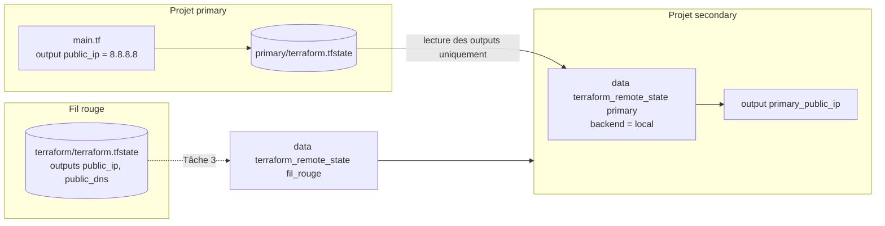

# Lab 10 — Lire l'état d'un autre projet

> **Durée :** 20 min · **Jour 2** · **Adapté de :** Lab 10 *State*

## Objectif

Comprendre comment un projet Terraform peut **consommer les outputs d'un autre projet** avec la source de données `terraform_remote_state`. On utilise l'exemple le plus simple possible (deux projets sur le même disque, backend `local`), puis on l'applique au projet fil rouge.

C'est la base des architectures découpées en couches : une équipe réseau publie le VNet, une équipe applicative le consomme.

## Schéma de l'objectif



## Prérequis

Les tâches 1 et 2 ne nécessitent **aucune** connexion à Azure. La tâche 3 suppose que le projet fil rouge est toujours déployé.

---

## Tâche 1 : créer une configuration qui définit un output

### Étape 1.1

```bash
mkdir -p ~/terraform-azure/lab10/primary && cd $_
```

`primary/main.tf` (c'est tout le contenu du fichier) :

```hcl
# primary/main.tf
output "public_ip" {
  value = "8.8.8.8"
}
```

### Étape 1.2 : générer le fichier d'état

```bash
terraform init
terraform apply
ls terraform.tfstate
```

---

## Tâche 2 : lire un output depuis l'état de ce projet

### Étape 2.1

```bash
mkdir -p ~/terraform-azure/lab10/secondary && cd $_
```

`secondary/main.tf` :

```hcl
# secondary/main.tf
# Lire l'état d'une autre configuration Terraform
data "terraform_remote_state" "primary" {
  backend = "local"

  config = {
    path = "../primary/terraform.tfstate"
  }
}
```

```bash
terraform init
```

### Étape 2.2 : exposer la valeur lue

Ajoutez :

```hcl
output "primary_public_ip" {
  value = data.terraform_remote_state.primary.outputs.public_ip
}
```

```bash
terraform apply
```

```text
Apply complete! Resources: 0 added, 0 changed, 0 destroyed.

Outputs:

primary_public_ip = "8.8.8.8"
```

> Seuls les **outputs** du projet source sont accessibles, pas ses ressources internes. C'est un contrat d'interface entre projets.

---

## Tâche 3 : lire l'état du projet fil rouge

Toujours dans `secondary/main.tf`, ajoutez :

```hcl
data "terraform_remote_state" "fil_rouge" {
  backend = "local"

  config = {
    path = "../../terraform/terraform.tfstate"
  }
}

output "serveurs_web" {
  value = {
    ips  = data.terraform_remote_state.fil_rouge.outputs.public_ip
    urls = [for d in data.terraform_remote_state.fil_rouge.outputs.public_dns : "http://${d}"]
  }
}
```

```bash
terraform apply
```

Vous obtenez les IP et les URL des serveurs web du fil rouge, **sans aucun accès à Azure** : seule la lecture du fichier d'état est nécessaire.

## Vérification

- [ ] `secondary` affiche `primary_public_ip = "8.8.8.8"`.
- [ ] `secondary` affiche les URL des serveurs du fil rouge.

## Point de discussion

Un état **local** pose plusieurs problèmes en équipe : pas de partage, pas de verrouillage, risque de perte, secrets en clair sur un poste. Le lab suivant stocke l'état dans Azure.
