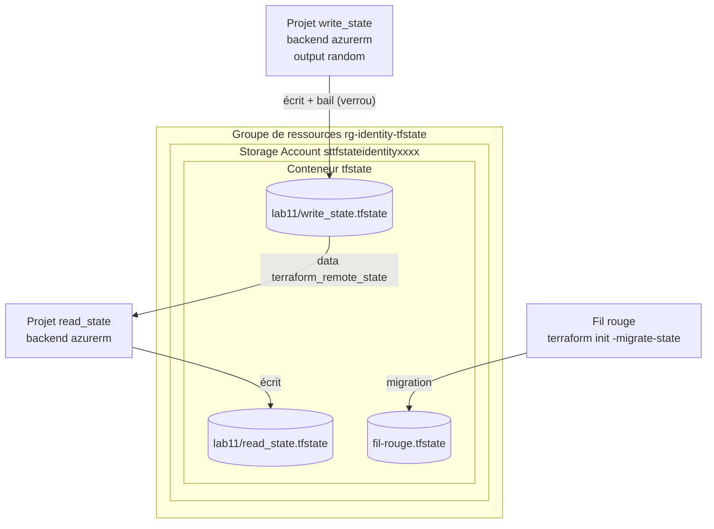

# Lab 11 — Stocker l'état dans Azure Storage

> **Durée :** 45 min · **Jour 2** · **Adapté de :** Lab 11 *Store State Remotely on Terraform Cloud*

## Objectif

Remplacer l'état local par un **état distant partagé et verrouillé** dans un compte de stockage Azure (backend `azurerm`) :

- préparer le compte de stockage et le conteneur qui hébergeront les états ;
- créer un projet qui écrit son état dans Azure ;
- créer un second projet qui **lit** cet état avec `terraform_remote_state` ;
- observer le **verrouillage** (bail de blob) et migrer l'état du fil rouge.

> Le lab d'origine utilisait Terraform Cloud comme backend. Sur Azure, le backend natif est un Storage Account ; HCP Terraform est abordé au lab 12.

## Schéma de l'objectif



---

## Tâche 1 : préparer le stockage des états

Le stockage de l'état doit exister **avant** le projet qui l'utilise (problème de « l'œuf et la poule »). On le crée ici avec l'Azure CLI.

```bash
IDENTITY="<identity>"
RG="rg-${IDENTITY}-tfstate"
SA="sttfstate${IDENTITY}$RANDOM"   # 3 à 24 caractères, minuscules et chiffres, unique dans Azure
LOCATION="francecentral"

az group create --name "$RG" --location "$LOCATION"

az storage account create \
  --name "$SA" \
  --resource-group "$RG" \
  --location "$LOCATION" \
  --sku Standard_LRS \
  --min-tls-version TLS1_2 \
  --allow-blob-public-access false

# Versioning des blobs : permet de restaurer une version précédente de l'état
az storage account blob-service-properties update \
  --account-name "$SA" --resource-group "$RG" --enable-versioning true

ACCOUNT_KEY=$(az storage account keys list -g "$RG" -n "$SA" --query '[0].value' -o tsv)

az storage container create --name tfstate --account-name "$SA" --account-key "$ACCOUNT_KEY"

echo "Storage account : $SA"
```

Le backend `azurerm` peut s'authentifier avec la clé du compte via une variable d'environnement :

```bash
export ARM_ACCESS_KEY="$ACCOUNT_KEY"
```

> **En production**, on préfère l'authentification Entra ID (`use_azuread_auth = true`) avec le rôle *Storage Blob Data Contributor*, ce qui évite de manipuler des clés.

---

## Tâche 2 : un projet qui stocke son état dans Azure

### Étape 2.1

```bash
mkdir -p ~/terraform-azure/lab11/write_state && cd $_
```

### Étape 2.2 : configurer le backend

`write_state/main.tf` (remplacez `<SA>` par le nom de votre compte de stockage) :

```hcl
# write_state/main.tf
terraform {
  backend "azurerm" {
    resource_group_name  = "rg-<identity>-tfstate"
    storage_account_name = "<SA>"
    container_name       = "tfstate"
    key                  = "lab11/write_state.tfstate"
  }

  required_providers {
    random = {
      source  = "hashicorp/random"
      version = "~> 3.6"
    }
  }
}
```

### Étape 2.3 : générer un output aléatoire

```hcl
resource "random_id" "random" {
  keepers = {
    uuid = uuid()     # nouvelle valeur à chaque apply
  }
  byte_length = 8
}

output "random" {
  value = random_id.random.hex
}
```

### Étape 2.4 : provisionner

```bash
terraform init
terraform apply -auto-approve
```

Aucun fichier `terraform.tfstate` n'est créé localement. Vérifiez dans Azure :

```bash
az storage blob list --container-name tfstate --account-name "$SA" --account-key "$ARM_ACCESS_KEY" -o table
```

Dans le portail Azure (Storage Account → Conteneurs → `tfstate`), ouvrez le blob : c'est le JSON de l'état.

---

## Tâche 3 : un projet qui lit l'état distant

### Étape 3.1

```bash
mkdir -p ~/terraform-azure/lab11/read_state && cd $_
```

### Étape 3.2 : backend et ressource aléatoire

`read_state/main.tf` :

```hcl
# read_state/main.tf
terraform {
  backend "azurerm" {
    resource_group_name  = "rg-<identity>-tfstate"
    storage_account_name = "<SA>"
    container_name       = "tfstate"
    key                  = "lab11/read_state.tfstate"
  }

  required_providers {
    random = {
      source  = "hashicorp/random"
      version = "~> 3.6"
    }
  }
}

resource "random_id" "random" {
  keepers = {
    uuid = uuid()
  }
  byte_length = 8
}
```

### Étape 3.3 : lire l'état de `write_state`

```hcl
data "terraform_remote_state" "write_state" {
  backend = "azurerm"

  config = {
    resource_group_name  = "rg-<identity>-tfstate"
    storage_account_name = "<SA>"
    container_name       = "tfstate"
    key                  = "lab11/write_state.tfstate"
  }
}
```

### Étape 3.4 : afficher les deux valeurs

```hcl
output "random" {
  value = random_id.random.hex
}

output "write_state_random" {
  value = data.terraform_remote_state.write_state.outputs.random
}
```

### Étape 3.5 : exécuter

```bash
terraform init
terraform apply -auto-approve
```

```text
Apply complete! Resources: 1 added, 0 changed, 0 destroyed.

Outputs:

random = "c1597ca0fbba3997"
write_state_random = "0de9168d0b78ead6"
```

Les deux valeurs sont distinctes : `write_state_random` provient bien de l'autre projet.

---

## Tâche 4 : observer le verrouillage

Ouvrez **deux terminaux** dans `write_state` (avec `ARM_ACCESS_KEY` exporté dans les deux).

- Terminal 1 : `terraform apply` et **ne répondez pas** à la confirmation.
- Terminal 2 : `terraform apply`.

```text
Error: Error acquiring the state lock
Error message: state blob is already locked
Lock Info:
  ID:        a1b2c3d4-...
  Path:      tfstate/lab11/write_state.tfstate
  Operation: OperationTypeApply
  Who:       student01@poste
```

Le backend `azurerm` pose un **bail (lease)** sur le blob pendant l'opération. Répondez `no` dans le terminal 1 : le verrou est libéré.

> En cas de verrou orphelin (crash), on peut le libérer avec `terraform force-unlock <ID>`, avec précaution.

---

## Tâche 5 : migrer l'état du fil rouge

```bash
cd ~/terraform-azure/terraform
```

Ajoutez dans le bloc `terraform { }` de `main.tf` :

```hcl
  backend "azurerm" {
    resource_group_name  = "rg-<identity>-tfstate"
    storage_account_name = "<SA>"
    container_name       = "tfstate"
    key                  = "fil-rouge.tfstate"
  }
```

```bash
terraform init -migrate-state
```

```text
Do you want to copy existing state to the new backend?
  Enter a value: yes
```

```bash
terraform plan      # No changes : l'état a bien été migré
```

Vous pouvez ensuite supprimer les fichiers `terraform.tfstate*` locaux.

> Le projet `lab10/secondary` lisait l'état local du fil rouge : il faudrait désormais passer à `backend = "azurerm"` dans son `terraform_remote_state`.

## Vérification

- [ ] Les blobs `lab11/write_state.tfstate`, `lab11/read_state.tfstate` et `fil-rouge.tfstate` existent dans le conteneur.
- [ ] Vous avez provoqué et compris l'erreur de verrouillage.
- [ ] `terraform plan` sur le fil rouge indique **No changes** après la migration.

## Pour aller plus loin : backend HCP Terraform

L'équivalent direct du lab d'origine utilise le bloc `cloud` (le backend `remote` est l'ancienne syntaxe) :

```hcl
terraform {
  cloud {
    organization = "<ORGANISATION>"
    workspaces {
      name = "lab11-write-state"
    }
  }
}
```

Authentification : `terraform login`.
