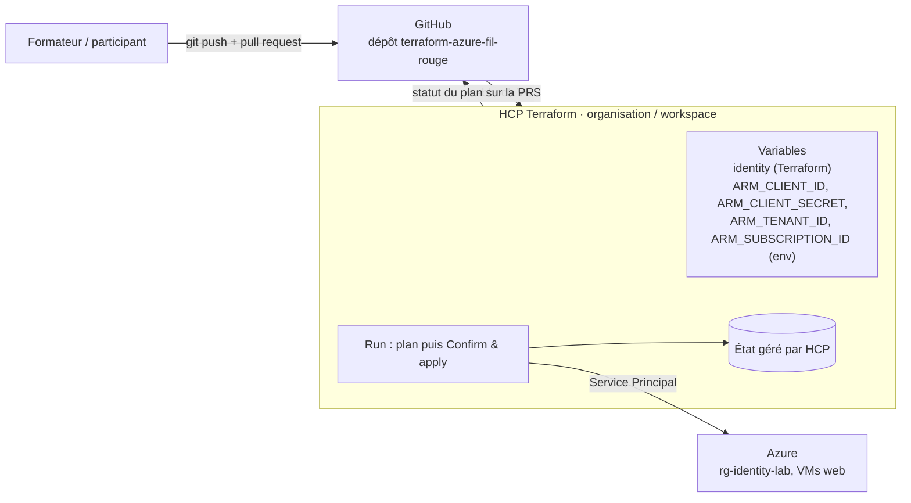

# Lab 12 — HCP Terraform et GitHub (workflow VCS)

> **Durée :** 75 min · **Jour 2** · **Adapté de :** Lab 12 *Terraform Cloud Basics*

## Objectif

Mettre en place un **workflow GitOps** pour l'infrastructure Azure :

- connecter **HCP Terraform** (anciennement Terraform Cloud) à un dépôt GitHub contenant le fil rouge ;
- fournir à HCP Terraform les identifiants Azure du Service Principal (variables d'environnement `ARM_*`) ;
- observer un plan qui échoue, le corriger par une **pull request** et voir le plan spéculatif s'exécuter sur la PR ;
- valider et appliquer depuis l'interface, puis détruire l'infrastructure.

## Schéma de l'objectif



## Prérequis

- Un compte HCP Terraform gratuit : <https://app.terraform.io/>.
- Un compte GitHub.
- Le Service Principal créé au lab 01 (`appId`, `password`, `tenant`).

---

## Tâche 1 : connecter GitHub à HCP Terraform

### Étape 1.1 : préparer le dépôt

HCP Terraform va gérer **son propre état**. Pour éviter deux copies de la même infrastructure, détruisez d'abord le fil rouge :

```bash
cd ~/terraform-azure/terraform
terraform destroy
```

Préparez ensuite le code pour une exécution distante :

1. Supprimez le bloc `backend "azurerm" { ... }` ajouté au lab 11 (l'état sera stocké par HCP Terraform).
2. Supprimez la source de données `azurerm_resource_group.shared` et son output (lab 09) : ce groupe de ressources n'existe plus.
3. Créez un fichier `.gitignore` :

```gitignore
.terraform/
*.tfstate
*.tfstate.*
*.tfvars
keys/
crash.log
```

4. Créez sur GitHub un dépôt **vide** nommé `terraform-azure-fil-rouge`, puis poussez le code :

```bash
git init -b main
git add .
git commit -m "Fil rouge Terraform Azure"
git remote add origin https://github.com/<github-user>/terraform-azure-fil-rouge.git
git push -u origin main
```

> Le fichier `.terraform.lock.hcl` **doit** être versionné : il garantit que HCP Terraform utilise les mêmes versions de providers que vous.

### Étape 1.2 : créer l'organisation et le workspace

1. Sur <https://app.terraform.io/>, créez une organisation (nom unique) si vous n'en avez pas.
2. **New → Workspace** → **Version Control Workflow**.
3. Choisissez **GitHub → GitHub.com**. Une fenêtre demande d'autoriser HCP Terraform sur votre compte GitHub : cliquez **Authorize**.
4. Sélectionnez le dépôt `terraform-azure-fil-rouge`.
5. Laissez le nom du workspace et les options avancées par défaut, puis cliquez **Create**.

HCP Terraform récupère la configuration (*Configuration uploaded successfully*).

---

## Tâche 2 : configurer les variables

Ouvrez l'onglet **Variables** du workspace. Il en existe deux types :

- **Terraform variables** : équivalent de `terraform.tfvars` ;
- **Environment variables** : injectées dans l'environnement d'exécution de Terraform.

### Étape 2.1 : variable Terraform

| Clé | Valeur | Sensible |
|---|---|---|
| `identity` | `<identity>` | non |

### Étape 2.2 : identifiants Azure (variables d'environnement)

HCP Terraform s'exécute sur ses propres machines : il n'a pas accès à votre session `az login`. On lui fournit le Service Principal :

| Clé | Valeur | Sensible |
|---|---|---|
| `ARM_CLIENT_ID` | `appId` du Service Principal | non |
| `ARM_CLIENT_SECRET` | `password` du Service Principal | **oui** |
| `ARM_TENANT_ID` | `tenant` | non |
| `ARM_SUBSCRIPTION_ID` | ID de l'abonnement | non |

Une variable marquée **Sensitive** est en écriture seule : elle n'est plus jamais affichée dans l'interface. Cliquez **Save variable** pour chacune.

---

## Tâche 3 : lancer un plan (il va échouer)

**Actions → Start new run** (type *Plan only* ou *Plan and apply*). Indiquez une raison, puis ouvrez le détail du run.

```text
Error: No value for required variable

  on variables.tf line 1:
   1: variable "subscription_id" {

The root module input variable "subscription_id" is not set, and has no default value.
```

C'est voulu : au lab 04, on a ajouté `subscription_id = var.subscription_id` dans le provider, mais la valeur était dans `terraform.tfvars`, que l'on n'a pas versionné. Plutôt que d'ajouter une variable de plus, on va laisser le provider lire `ARM_SUBSCRIPTION_ID`.

---

## Tâche 4 : corriger le code par une pull request

### Étape 4.1 : modifier le code dans une branche

Sur GitHub, ouvrez `main.tf`, cliquez sur l'icône crayon et modifiez le provider :

```hcl
provider "azurerm" {
  features {}
  # subscription_id est lu depuis la variable d'environnement ARM_SUBSCRIPTION_ID
}
```

Dans `variables.tf`, supprimez le bloc `variable "subscription_id"`.

En bas de page, sélectionnez **Create a new branch for this commit and start a pull request**, puis **Propose changes** et **Create pull request**.

> Vous pouvez aussi travailler en local : `git switch -c fix-subscription`, modifier, `git push -u origin fix-subscription`, puis ouvrir la PR.

### Étape 4.2 : le plan spéculatif

Après quelques secondes, la PR affiche un check **Terraform plan has changes** : HCP Terraform a exécuté un **plan spéculatif** (jamais appliqué) sur le code de la branche. Cliquez **Details** pour lire le plan : une quinzaine de ressources à créer.

### Étape 4.3 : fusionner

Cliquez **Merge pull request** puis **Confirm merge**.

---

## Tâche 5 : confirmer et appliquer

De retour dans HCP Terraform, onglet **Runs** : le commit de fusion a déclenché un nouveau run. Une fois le plan terminé, il attend une validation.

Cliquez **Confirm & apply**, ajoutez un commentaire si vous le souhaitez, puis **Confirm plan**.

Suivez l'exécution : les provisioners du lab 06 se connectent en SSH depuis les machines HCP Terraform (le NSG autorise le port 22 depuis Internet). À la fin, copiez une URL de l'output `public_dns` dans votre navigateur : la page Apache s'affiche.

Explorez ensuite l'onglet **States** : l'historique des versions de l'état est conservé.

---

## Tâche 6 : détruire

Dans le workspace : **Settings → Destruction and Deletion → Queue destroy plan**. Saisissez le nom du workspace pour confirmer, puis **Confirm & apply** sur le run de destruction.

> Le lab d'origine demandait une variable `CONFIRM_DESTROY=1` : elle n'est plus nécessaire dans les versions actuelles de HCP Terraform.

## Vérification

- [ ] La PR affiche le résultat du plan spéculatif.
- [ ] L'apply depuis HCP Terraform a créé les VM et la page web répond.
- [ ] L'infrastructure est détruite à la fin du lab.

## Pour aller plus loin : sans secret, avec OIDC

Plutôt qu'un `ARM_CLIENT_SECRET`, HCP Terraform peut utiliser des **identifiants dynamiques** (Workload Identity Federation) : on crée une *federated credential* sur l'application Entra ID, puis on définit dans le workspace `TFC_AZURE_PROVIDER_AUTH=true` et `TFC_AZURE_RUN_CLIENT_ID=<appId>`. Aucun secret n'est alors stocké.
