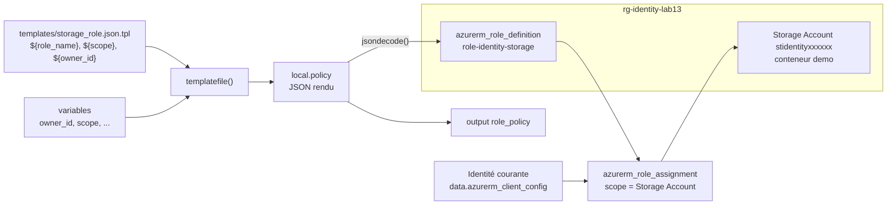

# Lab 13 — La fonction `templatefile` et Azure RBAC

> **Durée :** 40 min · **Jour 2** · **Adapté de :** Lab 13 *Template Provider*

## Objectif

Générer du contenu dynamique à partir d'un **modèle de fichier** :

- écrire un modèle JSON avec des espaces réservés `${...}` ;
- le rendre avec la fonction `templatefile` en lui passant des variables ;
- utiliser le résultat pour créer des ressources Azure : un compte de stockage, un **rôle personnalisé Azure RBAC** et son attribution à l'identité courante.

> Sur AWS, le modèle produisait une politique IAM attachée à un bucket S3. Sur Azure, l'équivalent est une **définition de rôle RBAC** attribuée sur un Storage Account.

## Schéma de l'objectif



## Prérequis

- Tâches 1 et 2 : Terraform uniquement, aucune connexion à Azure.
- Tâche 3 : rôle **Owner** ou **User Access Administrator** sur l'abonnement ou le groupe de ressources (nécessaire pour créer des rôles et des attributions).

---

## Tâche 1 : créer un modèle

### Étape 1.1

```bash
mkdir -p ~/terraform-azure/lab13/templates && cd ~/terraform-azure/lab13/templates
```

Le nom du fichier est libre. On conseille le suffixe `.tpl` pour l'identifier comme modèle, précédé de l'extension du contenu (`.json`).

### Étape 1.2 : écrire le modèle

`templates/storage_role.json.tpl` :

```json
{
  "Name": "${role_name}",
  "Description": "Gestion des conteneurs et blobs du compte ${storage_account_name} par ${owner_id}",
  "Actions": [
    "Microsoft.Storage/storageAccounts/read",
    "Microsoft.Storage/storageAccounts/blobServices/containers/read",
    "Microsoft.Storage/storageAccounts/blobServices/containers/write",
    "Microsoft.Storage/storageAccounts/blobServices/containers/delete"
  ],
  "DataActions": [
    "Microsoft.Storage/storageAccounts/blobServices/containers/blobs/read",
    "Microsoft.Storage/storageAccounts/blobServices/containers/blobs/write",
    "Microsoft.Storage/storageAccounts/blobServices/containers/blobs/delete"
  ],
  "AssignableScopes": ["${scope}"]
}
```

- `Actions` : opérations du plan de contrôle (gérer le compte et les conteneurs).
- `DataActions` : opérations du plan de données (lire et écrire les blobs).
- La syntaxe `${variable}` n'utilise **aucun préfixe** (`var.`, `local.`…) : seules les valeurs passées explicitement à `templatefile` sont visibles.

---

## Tâche 2 : rendre le modèle avec `templatefile`

```bash
cd ~/terraform-azure/lab13
```

### Étape 2.1 : variables et local

`main.tf` :

```hcl
variable "owner_id" {
  default = "anaconda"
}

locals {
  storage_account_name = "st${var.owner_id}demo"

  policy = templatefile("${path.module}/templates/storage_role.json.tpl", {
    owner_id             = var.owner_id
    role_name            = "role-${var.owner_id}-storage"
    storage_account_name = local.storage_account_name
    scope                = "/subscriptions/00000000-0000-0000-0000-000000000000/resourceGroups/rg-${var.owner_id}-lab13"
  })
}
```

`path.module` rend le chemin robuste, même si le code est utilisé comme sous‑module.

### Étape 2.2 : afficher le résultat

```hcl
output "role_policy" {
  value = local.policy
}
```

### Étape 2.3 : exécuter

```bash
terraform init
terraform apply
```

```text
Outputs:

role_policy = <<EOT
{
  "Name": "role-anaconda-storage",
  "Description": "Gestion des conteneurs et blobs du compte stanacondademo par anaconda",
  ...
  "AssignableScopes": ["/subscriptions/00000000-0000-0000-0000-000000000000/resourceGroups/rg-anaconda-lab13"]
}
EOT
```

Testez dans la console :

```bash
terraform console
> jsondecode(local.policy).DataActions
```

> Le contenu rendu peut servir n'importe où : argument d'une ressource, d'un module, script `custom_data` d'une VM, etc.

---

## Tâche 3 : créer le stockage et attacher le rôle

### Étape 3.1 : utiliser votre identifiant

Remplacez la valeur par défaut de `owner_id` par votre identifiant (minuscules et chiffres uniquement, car il entre dans le nom du compte de stockage) :

```hcl
variable "owner_id" {
  default = "<identity>"
}
```

### Étape 3.2 : providers, groupe de ressources et compte de stockage

Remplacez le contenu de `main.tf` par :

```hcl
terraform {
  required_providers {
    azurerm = {
      source  = "hashicorp/azurerm"
      version = "~> 4.0"
    }
    random = {
      source  = "hashicorp/random"
      version = "~> 3.6"
    }
  }
}

provider "azurerm" {
  features {}
}

variable "owner_id" {
  default = "<identity>"
}

data "azurerm_client_config" "current" {}

resource "random_string" "suffix" {
  length  = 6
  upper   = false
  special = false
}

resource "azurerm_resource_group" "rg" {
  name     = "rg-${var.owner_id}-lab13"
  location = "francecentral"
}

resource "azurerm_storage_account" "demo" {
  name                            = "st${var.owner_id}${random_string.suffix.result}"
  resource_group_name             = azurerm_resource_group.rg.name
  location                        = azurerm_resource_group.rg.location
  account_tier                    = "Standard"
  account_replication_type        = "LRS"
  allow_nested_items_to_be_public = false
}

resource "azurerm_storage_container" "demo" {
  name                  = "demo"
  storage_account_id    = azurerm_storage_account.demo.id
  container_access_type = "private"
}
```

> Le lab d'origine utilisait `uuid()` dans le nom du bucket. `uuid()` change à **chaque** exécution, ce qui forcerait la recréation de la ressource à chaque `apply`. `random_string` génère une valeur une seule fois et la conserve dans l'état.

### Étape 3.3 : rendre le modèle avec les vraies valeurs et créer le rôle

```hcl
locals {
  policy = templatefile("${path.module}/templates/storage_role.json.tpl", {
    owner_id             = var.owner_id
    role_name            = "role-${var.owner_id}-storage"
    storage_account_name = azurerm_storage_account.demo.name
    scope                = azurerm_resource_group.rg.id
  })

  role = jsondecode(local.policy)
}

resource "azurerm_role_definition" "storage" {
  name        = local.role.Name
  description = local.role.Description
  scope       = azurerm_resource_group.rg.id

  permissions {
    actions      = local.role.Actions
    data_actions = local.role.DataActions
  }

  assignable_scopes = local.role.AssignableScopes
}

resource "azurerm_role_assignment" "me" {
  scope              = azurerm_storage_account.demo.id
  role_definition_id = azurerm_role_definition.storage.role_definition_resource_id
  principal_id       = data.azurerm_client_config.current.object_id
}

output "role_policy" {
  value = local.policy
}

output "storage_account" {
  value = azurerm_storage_account.demo.name
}
```

> Un rôle personnalisé peut être **défini** au niveau d'un abonnement ou d'un groupe de ressources (`AssignableScopes`), puis **attribué** à un niveau plus fin, ici le compte de stockage.

### Étape 3.4 : exécuter

```bash
terraform init -upgrade
terraform apply
```

```text
Plan: 6 to add, 0 to change, 0 to destroy.
...
Apply complete! Resources: 6 added, 0 changed, 0 destroyed.
```

### Étape 3.5 : tester le rôle

Attendez 1 à 2 minutes (propagation RBAC), puis déposez un fichier **avec votre identité Entra ID** (sans clé de compte) :

```bash
SA=$(terraform output -raw storage_account)
echo "Hello RBAC" > hello.txt
az storage blob upload --auth-mode login --account-name "$SA" \
  --container-name demo --name hello.txt --file hello.txt
az storage blob list --auth-mode login --account-name "$SA" --container-name demo -o table
```

Vérifiez dans le portail : Storage Account → **Contrôle d'accès (IAM)** → **Attributions de rôles**.

> Si vous êtes connecté avec le Service Principal (`ARM_*`), le rôle lui est attribué : utilisez `az login --service-principal ...` pour le test, ou exécutez Terraform avec `az login` utilisateur.

## Nettoyage

```bash
terraform destroy
```

## Vérification

- [ ] L'output `role_policy` affiche le JSON rendu avec vos valeurs.
- [ ] Le rôle `role-<identity>-storage` apparaît dans le portail.
- [ ] L'upload avec `--auth-mode login` fonctionne.
