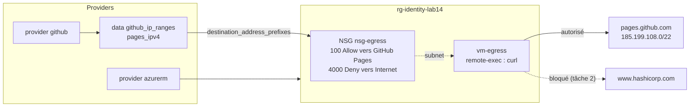

# Lab 14 — Multi‑provider : Azure et GitHub

> **Durée :** 40 min · **Jour 2** · **Adapté de :** Lab 14 *Multi‑provider*

## Objectif

Combiner **plusieurs providers** dans une même configuration :

- le provider `azurerm` pour créer une VM ;
- le provider `github` pour **lire** les plages d'adresses IP de GitHub Pages ;
- utiliser ces données pour restreindre le trafic sortant de la VM avec des règles **NSG** ;
- vérifier le résultat avec un provisioner qui teste deux destinations.

## Schéma de l'objectif



## Prérequis

- Identifiants Azure (`az login` ou variables `ARM_*`).
- Un compte GitHub et un **Personal Access Token** : GitHub → *Settings* → *Developer settings* → *Personal access tokens* → *Fine-grained tokens* → *Generate new token*. Aucune permission particulière n'est nécessaire pour lire les plages d'IP.

---

## Tâche 1 : une VM sans restriction de sortie

### Étape 1.1 : créer le projet

```bash
mkdir -p ~/terraform-azure/lab14 && cd $_
```

### Étape 1.2 : les variables

`terraform.tfvars` (ne pas versionner) :

```hcl
github_token = "github_pat_xxxxxxxx"
github_owner = "<github-user>"
identity     = "<identity>"
```

`variables.tf` :

```hcl
variable "github_token" {
  type      = string
  sensitive = true
}

variable "github_owner" {
  type = string
}

variable "identity" {
  type = string
}

variable "location" {
  type    = string
  default = "francecentral"
}
```

### Étape 1.3 : les deux providers

`main.tf` :

```hcl
terraform {
  required_providers {
    azurerm = {
      source  = "hashicorp/azurerm"
      version = "~> 4.0"
    }
    github = {
      source  = "integrations/github"
      version = "~> 6.0"
    }
    tls = {
      source  = "hashicorp/tls"
      version = "~> 4.0"
    }
  }
}

provider "azurerm" {
  features {}
}

# Configurer le provider GitHub
provider "github" {
  token = var.github_token
  owner = var.github_owner
}

# Plages d'IP publiées par GitHub (hooks, git, pages, actions...)
data "github_ip_ranges" "gh" {}
```

Comme pour `azurerm`, chaque provider a ses propres paramètres, sources de données et ressources : consultez la documentation du provider GitHub sur le registre.

### Étape 1.4 : réseau et VM

Ajoutez à `main.tf` :

```hcl
resource "azurerm_resource_group" "rg" {
  name     = "rg-${var.identity}-lab14"
  location = var.location
}

resource "azurerm_virtual_network" "vnet" {
  name                = "vnet-lab14"
  address_space       = ["10.14.0.0/16"]
  location            = azurerm_resource_group.rg.location
  resource_group_name = azurerm_resource_group.rg.name
}

resource "azurerm_subnet" "vm" {
  name                 = "snet-vm"
  resource_group_name  = azurerm_resource_group.rg.name
  virtual_network_name = azurerm_virtual_network.vnet.name
  address_prefixes     = ["10.14.1.0/24"]
}

resource "azurerm_network_security_group" "egress" {
  name                = "nsg-egress"
  location            = azurerm_resource_group.rg.location
  resource_group_name = azurerm_resource_group.rg.name
}

resource "azurerm_network_security_rule" "ssh_in" {
  name                        = "Allow-SSH-In"
  priority                    = 100
  direction                   = "Inbound"
  access                      = "Allow"
  protocol                    = "Tcp"
  source_port_range           = "*"
  destination_port_range      = "22"
  source_address_prefix       = "*"
  destination_address_prefix  = "*"
  resource_group_name         = azurerm_resource_group.rg.name
  network_security_group_name = azurerm_network_security_group.egress.name
}

resource "azurerm_subnet_network_security_group_association" "vm" {
  subnet_id                 = azurerm_subnet.vm.id
  network_security_group_id = azurerm_network_security_group.egress.id
}

resource "tls_private_key" "ssh" {
  algorithm = "RSA"
  rsa_bits  = 4096
}

resource "azurerm_public_ip" "vm" {
  name                = "pip-egress"
  location            = azurerm_resource_group.rg.location
  resource_group_name = azurerm_resource_group.rg.name
  allocation_method   = "Static"
  sku                 = "Standard"
}

resource "azurerm_network_interface" "vm" {
  name                = "nic-egress"
  location            = azurerm_resource_group.rg.location
  resource_group_name = azurerm_resource_group.rg.name

  ip_configuration {
    name                          = "internal"
    subnet_id                     = azurerm_subnet.vm.id
    private_ip_address_allocation = "Dynamic"
    public_ip_address_id          = azurerm_public_ip.vm.id
  }
}

resource "azurerm_linux_virtual_machine" "vm" {
  name                  = "vm-egress"
  location              = azurerm_resource_group.rg.location
  resource_group_name   = azurerm_resource_group.rg.name
  size                  = "Standard_B1s"
  admin_username        = "azureuser"
  network_interface_ids = [azurerm_network_interface.vm.id]

  admin_ssh_key {
    username   = "azureuser"
    public_key = tls_private_key.ssh.public_key_openssh
  }

  os_disk {
    caching              = "ReadWrite"
    storage_account_type = "Standard_LRS"
  }

  source_image_reference {
    publisher = "Canonical"
    offer     = "ubuntu-24_04-lts"
    sku       = "server"
    version   = "latest"
  }

  # Les règles NSG doivent exister AVANT le test réseau du provisioner.
  # Aucune référence ne les relie à la VM : on déclare une dépendance explicite.
  depends_on = [azurerm_subnet_network_security_group_association.vm]

  connection {
    type        = "ssh"
    user        = "azureuser"
    private_key = tls_private_key.ssh.private_key_pem
    host        = self.public_ip_address
  }

  provisioner "remote-exec" {
    inline = [
      "echo '--- GitHub Pages ---'",
      "curl -s -o /dev/null -w 'HTTP %%{http_code}\\n' --max-time 10 https://pages.github.com",
      "echo '--- hashicorp.com ---'",
      "curl -s -o /dev/null -w 'HTTP %%{http_code}\\n' --max-time 10 https://www.hashicorp.com",
    ]
  }
}

output "github_pages_ipv4" {
  value = data.github_ip_ranges.gh.pages_ipv4
}
```

> `%%{` est l'échappement HCL de `%{`, qui sinon serait interprété comme une directive de template.

### Étape 1.5 : initialiser et appliquer

```bash
terraform init
terraform apply -auto-approve
```

```text
azurerm_linux_virtual_machine.vm (remote-exec): --- GitHub Pages ---
azurerm_linux_virtual_machine.vm (remote-exec): HTTP 200
azurerm_linux_virtual_machine.vm (remote-exec): --- hashicorp.com ---
azurerm_linux_virtual_machine.vm (remote-exec): HTTP 200
...
Outputs:

github_pages_ipv4 = tolist([   # exemple, la liste réelle peut varier
  "192.30.252.153/32",
  "192.30.252.154/32",
  "185.199.108.0/22",
])
```

Les deux destinations répondent : par défaut, un NSG Azure autorise tout le trafic sortant vers Internet (règle `AllowInternetOutBound`, priorité 65001).

Détruisez l'infrastructure pour repartir de zéro :

```bash
terraform destroy -auto-approve
```

---

## Tâche 2 : n'autoriser la sortie que vers GitHub Pages

### Étape 2.1 : ajouter les règles sortantes

Ajoutez à `main.tf` :

```hcl
resource "azurerm_network_security_rule" "allow_github_pages" {
  name                         = "Allow-GitHub-Pages-Out"
  priority                     = 100
  direction                    = "Outbound"
  access                       = "Allow"
  protocol                     = "*"
  source_port_range            = "*"
  destination_port_range       = "*"
  source_address_prefix        = "*"
  destination_address_prefixes = data.github_ip_ranges.gh.pages_ipv4
  resource_group_name          = azurerm_resource_group.rg.name
  network_security_group_name  = azurerm_network_security_group.egress.name
}

resource "azurerm_network_security_rule" "deny_internet" {
  name                        = "Deny-Internet-Out"
  priority                    = 4000
  direction                   = "Outbound"
  access                      = "Deny"
  protocol                    = "*"
  source_port_range           = "*"
  destination_port_range      = "*"
  source_address_prefix       = "*"
  destination_address_prefix  = "Internet"   # service tag Azure
  resource_group_name         = azurerm_resource_group.rg.name
  network_security_group_name = azurerm_network_security_group.egress.name
}
```

Et complétez le `depends_on` de la VM pour que les règles soient en place avant le test :

```hcl
  depends_on = [
    azurerm_subnet_network_security_group_association.vm,
    azurerm_network_security_rule.allow_github_pages,
    azurerm_network_security_rule.deny_internet,
  ]
```

| Priorité | Règle | Effet |
|---|---|---|
| 100 | Allow vers `pages_ipv4` | GitHub Pages autorisé |
| 4000 | Deny vers `Internet` | tout le reste bloqué |
| 65001 | `AllowInternetOutBound` (par défaut) | jamais atteinte |

> Le trafic de retour des connexions SSH entrantes reste autorisé : les NSG sont **stateful**. La résolution DNS fonctionne aussi, car l'adresse de la plateforme Azure `168.63.129.16` n'est pas soumise aux NSG.

### Étape 2.2 : appliquer et observer l'échec (volontaire)

```bash
terraform apply -auto-approve
```

```text
azurerm_linux_virtual_machine.vm (remote-exec): --- GitHub Pages ---
azurerm_linux_virtual_machine.vm (remote-exec): HTTP 200
azurerm_linux_virtual_machine.vm (remote-exec): --- hashicorp.com ---
azurerm_linux_virtual_machine.vm (remote-exec): HTTP 000
╷
│ Error: remote-exec provisioner error
│ ... error executing "/tmp/terraform_xxxx.sh": Process exited with status 28
```

GitHub Pages répond, mais `hashicorp.com` n'est plus joignable : le code 28 de `curl` correspond à un délai dépassé. La VM est marquée **tainted** suite à l'échec du provisioner.

Relisez le bloc `remote-exec` de la VM pour bien comprendre le test.

### Étape 2.3 : détruire

```bash
terraform destroy -auto-approve
```

## Vérification

- [ ] Tâche 1 : les deux `curl` renvoient un code HTTP.
- [ ] Tâche 2 : seul GitHub Pages répond, et le provisioner échoue sur `hashicorp.com`.
- [ ] Vous savez expliquer pourquoi `depends_on` est nécessaire ici.
