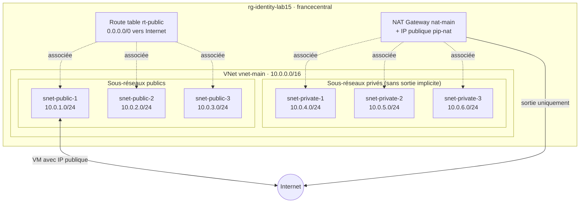

# Lab 15 — Réseau virtuel Azure complet (VNet)

> **Durée :** 50 min · **Jour 2** · **Adapté de :** Lab 15 *VPC*

## Objectif

Construire avec Terraform un réseau Azure prêt pour la production, équivalent du VPC AWS à 3 sous‑réseaux publics et 3 privés :

- un **VNet** `10.0.0.0/16` ;
- **3 sous‑réseaux publics** et **3 sous‑réseaux privés** en `/24`, générés avec `for_each` ;
- une **table de routage** associée aux sous‑réseaux publics ;
- une **NAT Gateway** pour la sortie Internet des sous‑réseaux privés ;
- comprendre les différences de conception entre AWS et Azure.

## Schéma de l'objectif



## AWS et Azure : ce qui change

| AWS (lab d'origine) | Azure |
|---|---|
| `aws_vpc` | `azurerm_virtual_network` |
| Subnet lié à **une** zone de disponibilité | Subnet **régional**, couvrant toutes les zones. La zone se choisit sur la VM ou l'IP publique |
| `map_public_ip_on_launch` | Pas d'équivalent : une VM est « publique » si on lui associe une IP publique |
| Internet Gateway obligatoire | Pas de ressource : le routage vers Internet est assuré par les **routes système** |
| Route table + associations | `azurerm_route_table` + `azurerm_subnet_route_table_association` |
| NAT Gateway | `azurerm_nat_gateway` |
| Subnet privé = pas de route vers l'IGW | `default_outbound_access_enabled = false` + NAT Gateway |
| `enable_dns_support`, `enable_dns_hostnames` | Activés par défaut (DNS Azure `168.63.129.16`) |

> Azure réserve **5 adresses** par sous‑réseau (`.0`, `.1`, `.2`, `.3` et `.255`) : un `/24` offre donc 251 adresses utilisables.

---

## Étape 1 : créer le VNet

```bash
mkdir -p ~/terraform-azure/lab15-16 && cd $_
```

`provider.tf` :

```hcl
terraform {
  required_providers {
    azurerm = {
      source  = "hashicorp/azurerm"
      version = "~> 4.0"
    }
  }
}

provider "azurerm" {
  features {}
}
```

`vars.tf` :

```hcl
variable "identity" {
  type = string
}

variable "location" {
  type    = string
  default = "francecentral"
}
```

`vnet.tf` :

```hcl
resource "azurerm_resource_group" "rg" {
  name     = "rg-${var.identity}-lab15"
  location = var.location
}

# Réseau principal
resource "azurerm_virtual_network" "main" {
  name                = "vnet-main"
  address_space       = ["10.0.0.0/16"]
  location            = azurerm_resource_group.rg.location
  resource_group_name = azurerm_resource_group.rg.name

  tags = {
    Name = "main"
  }
}
```

- `address_space = ["10.0.0.0/16"]` : plage d'adresses privées, découpée ensuite en sous‑réseaux `/24`.
- Le tag `Name` permet de repérer facilement le réseau dans le portail.

---

## Étape 2 : créer les sous‑réseaux

Le lab d'origine écrivait six blocs presque identiques. Grâce à `for_each` (lab 08), un seul bloc suffit.

Ajoutez à `vnet.tf` :

```hcl
locals {
  subnets = {
    public-1  = { cidr = "10.0.1.0/24", public = true }
    public-2  = { cidr = "10.0.2.0/24", public = true }
    public-3  = { cidr = "10.0.3.0/24", public = true }
    private-1 = { cidr = "10.0.4.0/24", public = false }
    private-2 = { cidr = "10.0.5.0/24", public = false }
    private-3 = { cidr = "10.0.6.0/24", public = false }
  }

  public_subnets  = { for k, v in local.subnets : k => v if v.public }
  private_subnets = { for k, v in local.subnets : k => v if !v.public }
}

resource "azurerm_subnet" "main" {
  for_each = local.subnets

  name                 = "snet-${each.key}"
  resource_group_name  = azurerm_resource_group.rg.name
  virtual_network_name = azurerm_virtual_network.main.name
  address_prefixes     = [each.value.cidr]

  # Sous-réseaux privés : pas d'accès sortant implicite, la sortie passera par la NAT Gateway
  default_outbound_access_enabled = each.value.public
}
```

- `each.key` vaut `public-1`, `private-2`, etc. ; `each.value.cidr` la plage associée.
- Les ressources sont adressées par clé : `azurerm_subnet.main["public-1"]`.
- Les expressions `for ... if` filtrent la map pour obtenir les sous‑réseaux publics ou privés.

---

## Étape 3 : l'accès Internet des sous‑réseaux publics

Sur AWS, il fallait créer une Internet Gateway. Sur Azure, chaque sous‑réseau dispose déjà de **routes système**, dont `0.0.0.0/0 → Internet`. Une VM disposant d'une IP publique peut donc communiquer avec Internet sans ressource supplémentaire.

Vérifiez‑le après l'`apply` de l'étape 5, sur une VM (lab 16) :

```bash
az network nic show-effective-route-table -g rg-<identity>-lab15 -n nic-web -o table
```

---

## Étape 4 : la table de routage publique

Pour reproduire explicitement la logique du lab d'origine (et pouvoir plus tard la modifier, par exemple vers un pare‑feu), on crée une table de routage :

```hcl
# Table de routage des sous-réseaux publics
resource "azurerm_route_table" "public" {
  name                = "rt-public"
  location            = azurerm_resource_group.rg.location
  resource_group_name = azurerm_resource_group.rg.name

  route {
    name           = "default-to-internet"
    address_prefix = "0.0.0.0/0"
    next_hop_type  = "Internet"
  }

  tags = {
    Name = "main-public"
  }
}
```

Tout trafic dont la destination n'est pas dans le VNet (par exemple un site web) est envoyé vers Internet.

---

## Étape 5 : associer la table de routage aux sous‑réseaux publics

La table n'est prise en compte que si elle est **associée** aux sous‑réseaux. Un seul bloc `for_each` remplace les trois associations du lab d'origine :

```hcl
resource "azurerm_subnet_route_table_association" "public" {
  for_each = local.public_subnets

  subnet_id      = azurerm_subnet.main[each.key].id
  route_table_id = azurerm_route_table.public.id
}
```

---

## Étape 6 : la NAT Gateway des sous‑réseaux privés

Les VM des sous‑réseaux privés n'ont pas d'IP publique. Pour qu'elles puissent sortir (mises à jour, appels d'API) sans être joignables depuis Internet, on ajoute une NAT Gateway :

```hcl
resource "azurerm_public_ip" "nat" {
  name                = "pip-nat"
  location            = azurerm_resource_group.rg.location
  resource_group_name = azurerm_resource_group.rg.name
  allocation_method   = "Static"
  sku                 = "Standard"
}

resource "azurerm_nat_gateway" "main" {
  name                    = "nat-main"
  location                = azurerm_resource_group.rg.location
  resource_group_name     = azurerm_resource_group.rg.name
  sku_name                = "Standard"
  idle_timeout_in_minutes = 10
}

resource "azurerm_nat_gateway_public_ip_association" "main" {
  nat_gateway_id       = azurerm_nat_gateway.main.id
  public_ip_address_id = azurerm_public_ip.nat.id
}

resource "azurerm_subnet_nat_gateway_association" "private" {
  for_each = local.private_subnets

  subnet_id      = azurerm_subnet.main[each.key].id
  nat_gateway_id = azurerm_nat_gateway.main.id
}
```

> **Coût :** la NAT Gateway est facturée à l'heure, même sans trafic. Détruisez‑la à la fin des labs 15 et 16.

---

## Étape 7 : outputs et déploiement

`outputs.tf` :

```hcl
output "subnet_ids" {
  value = { for k, s in azurerm_subnet.main : k => s.id }
}

output "nat_public_ip" {
  value = azurerm_public_ip.nat.ip_address
}
```

`terraform.tfvars` :

```hcl
identity = "<identity>"
```

```bash
terraform init
terraform plan     # 18 to add
terraform apply
```

Vérifiez :

```bash
az network vnet subnet list -g rg-<identity>-lab15 --vnet-name vnet-main \
  --query "[].{nom:name, plage:addressPrefix, routeTable:routeTable.id!=null, nat:natGateway.id!=null}" -o table
```

> **Ne détruisez pas** ce réseau : le lab 16 déploie une VM dedans.

## Vérification

- [ ] Le VNet contient 6 sous‑réseaux.
- [ ] Les 3 sous‑réseaux publics sont associés à `rt-public`.
- [ ] Les 3 sous‑réseaux privés sont associés à `nat-main`.

## Pour aller plus loin

- Remplacer le code par le module vérifié `Azure/avm-res-network-virtualnetwork/azurerm`.
- Calculer les plages avec `cidrsubnet("10.0.0.0/16", 8, n)` au lieu de les écrire en dur.
