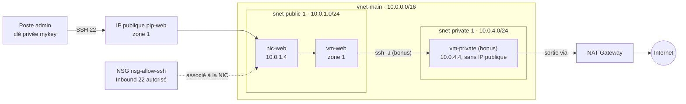

# Lab 16 — Machine virtuelle dans le VNet

> **Durée :** 40 min · **Jour 2** · **Adapté de :** Lab 16 *Créer une instance EC2 dans un VPC*

## Objectif

Déployer une VM Linux dans le réseau du lab 15 et vérifier son intégration réseau :

- placer la VM dans le sous‑réseau `snet-public-1` avec une IP publique ;
- la protéger avec un **NSG** qui n'autorise que SSH ;
- l'authentifier par une paire de clés SSH générée localement ;
- vérifier depuis la VM son adresse privée, son masque et ses routes ;
- en bonus, déployer une VM **privée** joignable uniquement via la première, et vérifier sa sortie par la NAT Gateway.

## Schéma de l'objectif



## Prérequis

Le réseau du lab 15 est déployé dans `~/terraform-azure/lab15-16`. On ajoute les fichiers de ce lab **dans le même répertoire** : la VM référence directement `azurerm_subnet.main["public-1"]`, et l'état reste unique.

> Le lab d'origine proposait de copier `terraform.tfstate` dans un nouveau répertoire. Travailler dans le même projet évite cette manipulation. Pour séparer réellement les deux couches, on utiliserait `terraform_remote_state` (labs 10 et 11).

---

## Étape 1 : préparer la paire de clés SSH

```bash
cd ~/terraform-azure/lab15-16
ssh-keygen -t rsa -b 4096 -f mykey -N ""
```

Deux fichiers sont créés : `mykey` (clé privée) et `mykey.pub` (clé publique).

---

## Étape 2 : la configuration de la VM

Ajoutez à `vars.tf` :

```hcl
variable "PATH_TO_PUBLIC_KEY" {
  default = "mykey.pub"
}

variable "INSTANCE_USERNAME" {
  default = "azureuser"
}
```

Créez `securitygroup.tf` :

```hcl
resource "azurerm_network_security_group" "allow_ssh" {
  name                = "nsg-allow-ssh"
  location            = azurerm_resource_group.rg.location
  resource_group_name = azurerm_resource_group.rg.name

  security_rule {
    name                       = "Allow-SSH"
    priority                   = 100
    direction                  = "Inbound"
    access                     = "Allow"
    protocol                   = "Tcp"
    source_port_range          = "*"
    destination_port_range     = "22"
    source_address_prefix      = "*"   # à restreindre à votre IP publique : "x.x.x.x/32"
    destination_address_prefix = "*"
  }

  tags = {
    Name = "allow-ssh"
  }
}
```

Créez `instance.tf` :

```hcl
resource "azurerm_public_ip" "web" {
  name                = "pip-web"
  location            = azurerm_resource_group.rg.location
  resource_group_name = azurerm_resource_group.rg.name
  allocation_method   = "Static"
  sku                 = "Standard"
  zones               = ["1"]
}

resource "azurerm_network_interface" "web" {
  name                = "nic-web"
  location            = azurerm_resource_group.rg.location
  resource_group_name = azurerm_resource_group.rg.name

  ip_configuration {
    name                          = "internal"
    # le sous-réseau du VNet
    subnet_id                     = azurerm_subnet.main["public-1"].id
    private_ip_address_allocation = "Dynamic"
    public_ip_address_id          = azurerm_public_ip.web.id
  }
}

# le groupe de sécurité, attaché à la carte réseau
resource "azurerm_network_interface_security_group_association" "web" {
  network_interface_id      = azurerm_network_interface.web.id
  network_security_group_id = azurerm_network_security_group.allow_ssh.id
}

resource "azurerm_linux_virtual_machine" "web" {
  name                  = "vm-web"
  location              = azurerm_resource_group.rg.location
  resource_group_name   = azurerm_resource_group.rg.name
  size                  = "Standard_B1s"
  zone                  = "1"
  admin_username        = var.INSTANCE_USERNAME
  network_interface_ids = [azurerm_network_interface.web.id]

  # la clé SSH publique
  admin_ssh_key {
    username   = var.INSTANCE_USERNAME
    public_key = file(var.PATH_TO_PUBLIC_KEY)
  }

  os_disk {
    caching              = "ReadWrite"
    storage_account_type = "Standard_LRS"
  }

  source_image_reference {
    publisher = "Canonical"
    offer     = "ubuntu-24_04-lts"
    sku       = "server"
    version   = "latest"
  }
}
```

- `subnet_id = azurerm_subnet.main["public-1"].id` : la VM obtient une adresse dans la plage `10.0.1.0/24`.
- `zone = "1"` : équivalent de l'`availability_zone` d'AWS. Sur Azure, la zone se fixe sur la VM et l'IP publique, pas sur le sous‑réseau. L'IP publique doit être dans la même zone que la VM, ou *zone-redundant*.
- Le NSG est attaché à la **carte réseau** (on peut aussi l'attacher au sous‑réseau, comme au lab 02).

Ajoutez à `outputs.tf` :

```hcl
output "vm_public_ip" {
  value = azurerm_public_ip.web.ip_address
}

output "vm_private_ip" {
  value = azurerm_linux_virtual_machine.web.private_ip_address
}
```

---

## Étape 3 : planifier et appliquer

```bash
terraform plan
```

Vérifiez dans le plan :

- le VNet et les sous‑réseaux **déjà créés** ne sont pas modifiés ;
- seules les ressources de la VM sont à créer (5 ressources).

```bash
terraform apply
```

---

## Étape 4 : tester la configuration

### 1. Se connecter en SSH

```bash
ssh -i mykey azureuser@$(terraform output -raw vm_public_ip)
```

> Vous pouvez aussi retrouver l'IP dans le fichier d'état, mais `terraform output` est bien plus pratique.

### 2. Vérifier l'adresse IP privée

Sur la VM :

```bash
ip a s eth0
```

L'adresse est dans la plage de `snet-public-1`, par exemple `10.0.1.4/24` (et non `.1`, `.2` ou `.3`, réservées par Azure). Le masque est bien `/24`.

> L'IP publique n'apparaît **pas** sur l'interface : sur Azure comme sur AWS, elle est traduite (NAT 1:1) par la plateforme.

### 3. Vérifier les routes

```bash
route -n        # ou : ip route
```

```text
Destination     Gateway         Genmask         Flags Metric Ref    Use Iface
0.0.0.0         10.0.1.1        0.0.0.0         UG    100    0        0 eth0
10.0.1.0        0.0.0.0         255.255.255.0   U     100    0        0 eth0
168.63.129.16   10.0.1.1        255.255.255.255 UGH   100    0        0 eth0
169.254.169.254 10.0.1.1        255.255.255.255 UGH   100    0        0 eth0
```

- `10.0.1.1` : la passerelle virtuelle Azure du sous‑réseau (première adresse réservée).
- `168.63.129.16` : DNS et services de la plateforme Azure.
- `169.254.169.254` : le service de métadonnées de l'instance (IMDS).

Testez le service de métadonnées, depuis la VM :

```bash
curl -s -H Metadata:true "http://169.254.169.254/metadata/instance/compute?api-version=2021-02-01" | python3 -m json.tool | grep -E '"(name|zone|vmSize|location)"'
```

Quittez la VM (`exit`).

---

## Bonus : une VM privée derrière la NAT Gateway

Ajoutez `instance-private.tf` :

```hcl
resource "azurerm_network_interface" "private" {
  name                = "nic-private"
  location            = azurerm_resource_group.rg.location
  resource_group_name = azurerm_resource_group.rg.name

  ip_configuration {
    name                          = "internal"
    subnet_id                     = azurerm_subnet.main["private-1"].id
    private_ip_address_allocation = "Dynamic"
    # aucune IP publique
  }
}

resource "azurerm_linux_virtual_machine" "private" {
  name                  = "vm-private"
  location              = azurerm_resource_group.rg.location
  resource_group_name   = azurerm_resource_group.rg.name
  size                  = "Standard_B1s"
  admin_username        = var.INSTANCE_USERNAME
  network_interface_ids = [azurerm_network_interface.private.id]

  admin_ssh_key {
    username   = var.INSTANCE_USERNAME
    public_key = file(var.PATH_TO_PUBLIC_KEY)
  }

  os_disk {
    caching              = "ReadWrite"
    storage_account_type = "Standard_LRS"
  }

  source_image_reference {
    publisher = "Canonical"
    offer     = "ubuntu-24_04-lts"
    sku       = "server"
    version   = "latest"
  }
}

output "vm_private_only_ip" {
  value = azurerm_linux_virtual_machine.private.private_ip_address
}
```

```bash
terraform apply

# Rebond via la VM publique (la clé est chargée dans l'agent SSH)
eval "$(ssh-agent -s)" && ssh-add mykey
ssh -J azureuser@$(terraform output -raw vm_public_ip) azureuser@$(terraform output -raw vm_private_only_ip)
```

Sur la VM privée :

```bash
curl -s https://ifconfig.me ; echo
```

L'adresse affichée est celle de la **NAT Gateway** (comparez avec `terraform output nat_public_ip`) : la VM sort vers Internet sans être joignable depuis Internet.

> En production, on remplace la VM de rebond par **Azure Bastion**.

---

## Nettoyage

```bash
terraform destroy
```

## Vérification

- [ ] Connexion SSH à `vm-web` avec `mykey`.
- [ ] `ip a s eth0` montre une adresse `10.0.1.x/24`.
- [ ] `route -n` montre la passerelle `10.0.1.1`.
- [ ] Bonus : `vm-private` sort avec l'IP de la NAT Gateway.
